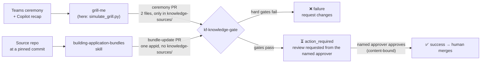

# kbundles — Knowledge Foundation knowledge bundles

**The governed home of Knowledge Foundation knowledge bundles.** A knowledge
bundle is the unit of knowledge in KF; the **application bundle** — deep,
code-grounded documentation of one application — is the first kind, and this
repository holds five of them. Every change arrives through a pull request
judged by **kf-knowledge-gate**, which enforces that only the allowed files
change, every claim carries verifiable evidence, and nothing is accepted
without the **named** human approver.

This is a working prototype of the *KF Grill-Me Architecture Specification
v0.4* plus the application-bundle layer from the
[confirmed plan](docs/plan/2026-10-20-knowledge-bundles-prototype-plan.md).
Meetings, teams and people in ceremony knowledge are **fabricated**
(`x_kf.synthetic: true`); the five application bundles describe real public
repositories.

## The five application bundles

| appid | Source (pinned commit) | Sections | Domain maps | Code graph nodes / edges |
|---|---|---:|---:|---:|
| [`kfcor`](application-bundles/kfcor/index.md) | [muthub-ai/knowledge-foundation](https://github.com/muthub-ai/knowledge-foundation) @ `78d41952391c` | 7 | 2 | 509 / 1090 |
| [`kfsit`](application-bundles/kfsit/index.md) | [muthub-ai/knowledge-foundation-site](https://github.com/muthub-ai/knowledge-foundation-site) @ `3afac247ec28` | 7 | 1 | 324 / 718 |
| [`folio`](application-bundles/folio/index.md) | [muthub-ai/muthu-v0-portfolio-website](https://github.com/muthub-ai/muthu-v0-portfolio-website) @ `8bca37ea8df4` | 7 | 2 | 443 / 814 |
| [`aacod`](application-bundles/aacod/index.md) | [muthub-ai/aac](https://github.com/muthub-ai/aac) @ `fcc5db4d74b5` | 7 | 2 | 1041 / 2462 |
| [`cfskl`](application-bundles/cfskl/index.md) | [muthub-ai/c4-skills](https://github.com/muthub-ai/c4-skills) @ `670fdcd9a8bc` | 7 | 1 | 156 / 124 |

Each bundle has seven sections — executive summary, business, application,
data, technology and security architecture, and an (illustrative) operating
model with 2–3 teams — plus domain maps, a reproducible tree-sitter code graph
with derived Mermaid views, and the OKF control files. **Every factual
paragraph, list item and table row cites source lines by hash**
(`src · path#La-Lb · sha256:…`) or a code-graph node; judgments are marked
`*Assessment:*` and may only reuse evidence already cited.

## Repository map

```text
kbundles/
├── application-bundles/<appid>/       # one application bundle per app (5-letter appid)
│   ├── index.md · log.md              # OKF reserved files (log is insert-only)
│   ├── OWNERS                         # who may approve this app's knowledge (read from main only)
│   ├── bundle-manifest.json           # one canonical line per bundle file; never touched by ceremony PRs
│   ├── knowledge-source.json          # source repo + immutable repo id + pinned commit + approver
│   ├── sections/*.md                  # 7 architecture sections with per-claim citations
│   ├── domains-maps/*.md              # domain vocabulary, cited
│   ├── code-graph/                    # code-graph.jsonl · metrics.json · views/*.md (derived)
│   └── knowledge-sources/agile-ceremonies/<ceremony>/<team>/   # candidate knowledge from ceremonies
├── .github/kf/config.yml              # TRUST ROOT: appid registry, teams, time zones, KF stewards, fallback approvers
├── .github/kf/toolchain.lock          # pinned tree-sitter toolchain (G11 compares against the base ref)
├── .github/workflows/                 # kf-gate · kf-gate-review → kf-gate-rerun · kf-tripwire · kf-fixtures
├── gate/                              # kf-knowledge-gate (one module per gate under gate/gates/)
├── skills/building-application-bundles/   # the skill + canonical kfbundle library + evals
├── tools/                             # simulate_grill.py · bootstrap.py · tripwire.py · bundle_builder/
├── scenarios/                         # matrix.yml · cases/ · seeds/ · recaps/ · run_fixtures.py
└── docs/                              # plan · bootstrap verdicts
```

## How knowledge gets in



| PR class | What it may change | Who must approve |
|---|---|---|
| **ceremony** | one ceremony file + that team's `log.md` — **only inside `knowledge-sources/agile-ceremonies/<ceremony>/<team>/`** | the approver named in the file, who must be in the app's `OWNERS` |
| **bundle-update** | `sections/`, `domains-maps/`, `code-graph/`, control files of one appid | the approver in `knowledge-source.json`, who must be in the app's `OWNERS` |
| **owners** | exactly `application-bundles/<appid>/OWNERS` | a current approver in that `OWNERS` — or a KF steward when the app has none yet (claim) |
| **revert** | the exact semantic inverse of one merged ceremony commit + a `Reverted` log block | the original approver or the fallback team |
| **tooling** | trust root and tooling (`.github/`, `gate/`, `tools/`, `skills/`, `scenarios/`) | a code owner |
| **other** | `README.md`, `PRODUCTION.md`, `docs/**` | nobody (protected-content rule still applies) |
| **unknown** | anything else, or any mix of the above | — fails closed |

### Gates

| Gate | Rule |
|---|---|
| G1 | Path allowlist: one appid + team; **only the ceremony file and its team log, both inside `knowledge-sources/`** — nothing else (not the manifest); no symlinks, submodules or mode changes |
| G2 | OKF + `x_kf` schema, ceremony profiles (allowed sections hard, expected sections soft), `knowledge_id` and `content_sha256` recomputed |
| G3 | Coherence, registry and **naming**: path ⇔ file name ⇔ branch ⇔ **PR title** ⇔ frontmatter; appid registered; team registered under that appid; date not in the future at UTC+14 |
| G4 | Additive-only: ceremony file added; team log created as title + one block or gains one block newest-first (insert-only) |
| G5 | The team-log block registers exactly the new file; its heading uses the run date in the team time zone |
| G6 | Every item cites a span; every span is in the PR body and hashes to its footnote |
| G7 | Approver resolvable, not the author, has write permission, and **listed in the app's `OWNERS`** (KF stewards while an app has none) |
| G8 | One ceremony file, ≤256 KB, UTF-8 |
| G9 | No emails, phone numbers or employee ids |
| G10 | Client trailer on every commit |
| B1–B6 | Bundle-update write-set, registry/branch/**title** coherence, manifest/log/index rules, **every section claim verified at the pinned SHA** |
| OW | Owners class: only `OWNERS` of one registered appid; branch `owners/<appid>`; title `[KF-OWNERS] <appid> — …`; valid logins with write access |
| G11 | Graph toolchain equals the base-ref lock; extractor re-run at the pinned SHA reproduces graph, metrics and views byte-for-byte |
| PC | Protected content on every PR: accepted ceremony knowledge is immutable; logs are insert-only |
| RV | Revert class: semantic inverse of one merged ceremony commit; bootstrapped content is never a revert target |
| Approval | `success` only when the named approver approved content identical to head (survives `--refresh`; stale on any content change) |

### Naming conventions (enforced)

| PR kind | Branch | Title |
|---|---|---|
| ceremony | `grill/<appid>/<ceremony>/<team>/<YYYY-MM-DD>` | `[KF] <appid> · <team> · <ceremony> · <YYYY-MM-DD> — candidate knowledge (<n> items)` |
| bundle-update | `bundle/<appid>/<first 12 of source commit>` | `[KF-BUNDLE] <appid> @ <first 12 of source commit> — <summary>` |
| owners | `owners/<appid>` | `[KF-OWNERS] <appid> — <what changed>` |

### OWNERS

Each app has `application-bundles/<appid>/OWNERS` — a YAML list of `approvers`
(GitHub logins). Nobody has to know every app's owners up front: an app
without an `OWNERS` file falls back to the **KF stewards** in the trust root,
and a team **claims** its app with an owners PR that a steward approves. From
then on the app's own approvers govern changes to it. The gate reads
`OWNERS` from `main` only, so no PR can approve itself into ownership.

## Scenario matrix

Every scenario below is replayed by `scenarios/run_fixtures.py` on a fresh
scratch clone in gate local mode (CI: `kf-fixtures`). Rows marked *live* are
also open as real pull requests.

<!-- scenario-matrix:start -->
**48/48 scenarios pass** (32s, gate local mode, fresh scratch clone per scenario).

| Id | Scenario | Proves (spec / plan) | Live PR | Observed | Result |
|---|---|---|---|---|---|
| F01 | Standup awaits the named approver; another writer's approval does not count; named approval passes | §13 #2, #3 · I3 · S first-contribution warn |  | ceremony:action_required warn[S] → ceremony:action_required → ceremony:success | ✅ |
| F02 | Rerun for the same meeting updates the same branch — no duplicate PRs | §13 #8 · I2 · D13 |  | ceremony:action_required | ✅ |
| F03 | Three established kfcor teams land same-day standups — zero conflicts, zero refresh, zero re-approval | §13 #7a · I9 (team isolation) |  | ceremony:success → squash-merged → ceremony:success → squash-merged → ceremony:success → squash-merged | ✅ |
| F04 | Two teams' FIRST sprint-planning entries land the same day — no manifest, so no conflict and no --refresh | spec v0.5 write-set (knowledge-sources/ only) · I9 |  | ceremony:success → squash-merged → ceremony:success → squash-merged | ✅ |
| F05 | --refresh two days after approval keeps the approval (dates frozen in the GrillResult) | §13 #8 · determinism rule §8.2 |  | squash-merged → ceremony:success | ✅ |
| F06 | Retro profile with Went well / To improve / ACT / RSK passes | §5.2 ceremony profiles |  | ceremony:action_required | ✅ |
| F07 | Valid revert — semantic inverse of a merged ceremony PR, approved by the original approver | §13 #11 · §8.5 revert class |  | squash-merged → revert:action_required → revert:success | ✅ |
| F08 | Bundle update — citations verified at the pinned SHA, graph reproduced, owner approves | D18 bundle-update class · G6-bundle · G11 |  | bundle-update:action_required → bundle-update:success | ✅ |
| F09 | Trust-root/tooling change needs a code owner's approval | plan §6.1 tooling class · P1 |  | tooling:action_required → tooling:success | ✅ |
| F10 | Docs-only change passes without approval | plan §6.1 other class |  | other:success | ✅ |
| F11 | Zero findings — no file, no PR | §13 #10 · I7 |  | zero findings → no file, no PR | ✅ |
| F12 | Clobber protection — the safe-push author check aborts on someone else's open PR | §7.2 step 1 · E6 |  | aborted: open PR #7 on grill/x belongs to @someone-else — aborting (a… | ✅ |
| R01 | Ceremony PR also touches a second appid | §13 #5 · G1 | yes | ceremony:failure [G1] | ✅ |
| R02 | Ceremony PR edits a bundle section (out of allowlist) | §13 #5 · G1 |  | ceremony:failure [G1] | ✅ |
| R03 | Wrong-appid coherence — path says kfcor, frontmatter says kfsit | D19 · G3 | yes | ceremony:failure [G2,G3] | ✅ |
| R04 | Unregistered appid folder | D19 registry · G3 |  | ceremony:failure [G3] | ✅ |
| R05 | Team not registered under the appid (team→appid binding) | D19 · G3 hard binding | yes | ceremony:failure [G3] | ✅ |
| R06 | Evidence span tampered — hash no longer matches | §13 #5 · G6 | yes | ceremony:failure [G6] | ✅ |
| R07 | Approver is the PR author | §13 #5 · G7 |  | ceremony:failure [G7] | ✅ |
| R08 | Email address in knowledge text | §13 #5 · G9 | yes | ceremony:failure [G9] | ✅ |
| R09 | Ceremony PR also rewrites the bundle manifest — outside knowledge-sources/ | spec v0.5 write-set · G1 · PC | yes | ceremony:failure [G1,PC] | ✅ |
| R10 | New ceremony-team log seeded with fabricated history | §13 #9 · G4 creation rule |  | ceremony:failure [G4] | ✅ |
| R13 | Ceremony PR touches the appid-root log.md | §13 #5 · D16 · G1 | yes | ceremony:failure [G1,PC] | ✅ |
| R14 | Trust-root config edited inside a knowledge PR — class unknown, fails closed | plan §6.1 · P1 | yes | unknown:failure [CLASS] | ✅ |
| R15 | RSK- item in a standup (profile violation) | §5.2 · G2 |  | ceremony:failure [G2] | ✅ |
| R16 | Ceremony date in the future in every time zone (UTC+14 rule) | §14 · G3 | yes | ceremony:failure [G3] | ✅ |
| R17 | Short (4-segment) grill branch | §14 · G3 |  | ceremony:failure [G3] | ✅ |
| R18 | Commit without the client trailer | G10 |  | ceremony:failure [G10] | ✅ |
| R19 | Symlink in a knowledge PR | §13 #5 · G1 |  | ceremony:failure [G1,G8] | ✅ |
| R20 | Rename of an accepted ceremony file (delete + add) without a revert | §13 #5 · protected content · revert class |  | revert:failure [G10,RV] | ✅ |
| R26 | Reserved team slug | §14 · G3 |  | ceremony:failure [G3] | ✅ |
| R12 | Literal git revert of a bootstrapped (never-approved) seed is rejected | §13 #11 · revert class · x_kf.bootstrap |  | revert:failure [RV] | ✅ |
| R31 | Ceremony PR title does not follow the naming convention | spec v0.5 naming · G3 | yes | ceremony:failure [G3] | ✅ |
| R32 | Named approver is not in the app's OWNERS (nor a steward) | spec v0.5 OWNERS · G7 | yes | ceremony:failure [G7] | ✅ |
| R33 | Approver owns a DIFFERENT app — their OWNERS entry does not carry over to kfcor | spec v0.5 OWNERS · cross-app isolation · G7 |  | ceremony:failure [G7] | ✅ |
| F13 | An app's OWNERS file is claimed by PR — a KF steward approves, then the app governs itself | spec v0.5 OWNERS claim |  | owners:action_required → owners:success | ✅ |
| R34 | OWNERS change approved by someone who is not a current approver — stays pending | spec v0.5 OWNERS · approval |  | owners:action_required | ✅ |
| R35 | OWNERS change on the wrong branch / with the wrong title | spec v0.5 naming · OW |  | owners:failure [OW] | ✅ |
| R36 | OWNERS change mixed with a section edit — fails closed | spec v0.5 · one kind of change per PR |  | unknown:failure [CLASS] | ✅ |
| R11 | Bundle update touches knowledge-sources/ | D18 · B1 | yes | bundle-update:failure [B1] | ✅ |
| R21 | Section made only of assessments (50% cap) | §6.3 G6-bundle rule (3) · confirm-round fixture |  | bundle-update:failure [B6] | ✅ |
| R22 | Graph claims a toolchain other than the base-ref lock | §6.4 G11 (i) · confirm-round fixture |  | bundle-update:failure [G11] | ✅ |
| R23 | Hand-edited graph does not reproduce byte-for-byte | §6.4 G11 (iii) |  | bundle-update:failure [G11] | ✅ |
| R24 | Mixed commit SHAs inside one bundle | §6.3 · B6 mixed-version rule |  | bundle-update:failure [B6] | ✅ |
| R25 | Uncited claim block in a section | §6.3 G6-bundle rule (1) |  | bundle-update:failure [B6] | ✅ |
| R37 | Bundle-update PR title does not follow the naming convention | spec v0.5 naming · B3 |  | bundle-update:failure [B3] | ✅ |
| R29 | Bundle-update approver is not an owner of the appid | D19 · G7 owners(appid) |  | bundle-update:failure [G7] | ✅ |
| R30 | Approved commit content differs from head — approval is stale, check stays pending | §8.2 content-bound approval |  | ceremony:action_required | ✅ |
<!-- scenario-matrix:end -->

### Live demo pull requests

<!-- live-prs:start -->
| Scenario | What it does | Pull request | Expected check |
|---|---|---|---|
| L01 | Live green ceremony: standup waits for @genlinemedia, passes on approval | [#11](https://github.com/muthub-ai/kbundles/pull/11) | action_required → success after @genlinemedia approves |
| L02 | Live green bundle update: cited aacod claim, owner @genlinemedia approves | [#12](https://github.com/muthub-ai/kbundles/pull/12) | action_required → success after @genlinemedia approves |
| R01 | Ceremony PR also touches a second appid | [#13](https://github.com/muthub-ai/kbundles/pull/13) | failure on G1 |
| R03 | Wrong-appid coherence — path says kfcor, frontmatter says kfsit | [#14](https://github.com/muthub-ai/kbundles/pull/14) | failure on G3 |
| R05 | Team not registered under the appid (team→appid binding) | [#15](https://github.com/muthub-ai/kbundles/pull/15) | failure on G3 |
| R06 | Evidence span tampered — hash no longer matches | [#16](https://github.com/muthub-ai/kbundles/pull/16) | failure on G6 |
| R08 | Email address in knowledge text | [#17](https://github.com/muthub-ai/kbundles/pull/17) | failure on G9 |
| R09 | Manifest re-serialized (parse→stringify) instead of byte-spliced | [#18](https://github.com/muthub-ai/kbundles/pull/18) | failure on G4 |
| R11 | Bundle update touches knowledge-sources/ | [#22](https://github.com/muthub-ai/kbundles/pull/22) | failure on B1 |
| R13 | Ceremony PR touches the appid-root log.md | [#19](https://github.com/muthub-ai/kbundles/pull/19) | failure on G1 |
| R14 | Trust-root config edited inside a knowledge PR — class unknown, fails closed | [#20](https://github.com/muthub-ai/kbundles/pull/20) | failure on CLASS |
| R16 | Ceremony date in the future in every time zone (UTC+14 rule) | [#21](https://github.com/muthub-ai/kbundles/pull/21) | failure on G3 |
<!-- live-prs:end -->

> **Demo-grade notes.** This repository has one real GitHub identity, so most
> live PRs also report a **G7** finding (the fixture approver `@kf-approver-demo`
> does not exist on GitHub) next to the gate it was built to trip; the approval,
> merge, refresh and revert paths are proven by the fixtures with fixture
> identities. The required check is posted by the GitHub Actions app, so a
> malicious writer could forge it — the KF Gate App setup that closes this is in
> [PRODUCTION.md](PRODUCTION.md).

## Runbook

```bash
pip install -r .github/kf/toolchain.lock                          # pinned toolchain (Python 3.11+)

# validate a bundle exactly as the gate does (needs a clone of the source repo at the pinned commit)
python3 skills/building-application-bundles/scripts/validate_bundle.py \
  --bundle application-bundles/kfcor --source ../knowledge-foundation \
  --registry .github/kf/config.yml --reproduce

# replay the whole scenario matrix (KF_SOURCE_CACHE=dir of source clones avoids network fetches)
python3 scenarios/run_fixtures.py [--only F01,R06]

# run the gate locally on any two refs
python3 gate/run.py --repo . --base main --head my-branch --pr-json pr.json \
  --identities scenarios/fixtures/identities.yml

# simulate a grill-me ceremony PR (commit locally, or --mode push to open a real PR)
python3 tools/simulate_grill.py --scenario scenarios/cases/D01-kfcor-fabric-core-standup.json --mode commit

# onboard or regenerate an application bundle: follow skills/building-application-bundles/SKILL.md
```

## How this repository was seeded

Per plan §7B the owner chose **direct bootstrap**: tooling first, then each
bundle and each team's seed standup as its own commit, every one judged by
`gate/run.py --bootstrap` against the previous commit. All content gates pass;
approval is recorded as *not applicable* and the content is flagged
`x_kf.bootstrap: true`, so it can never be a revert target. Verdicts:
[`docs/bootstrap-verdicts/`](docs/bootstrap-verdicts/).

## What the bundles found

Writing cited sections surfaced real issues in the source repos — each is
backed by line-level citations in the bundle:

- **aacod** — the OPA policies are tested but never evaluated against a model in CI, and the MCP
  "active waivers" resource filters on a lower-case status the schema never allows
  ([security architecture](application-bundles/aacod/sections/security-architecture.md)).
- **cfskl** — `c4designer/SKILL.md` frontmatter is not valid YAML (unquoted colons), which the grep-based tests
  never notice ([data architecture](application-bundles/cfskl/sections/data-architecture.md)).
- **folio** — the content check documented as covering email addresses only matches phone numbers
  ([security architecture](application-bundles/folio/sections/security-architecture.md)).
- **kfsit** — a failed preview build exits zero and renders its log as the page, so it can look like a good deploy
  ([technology architecture](application-bundles/kfsit/sections/technology-architecture.md)).
- **kfcor** — code defaults for the semantic layer differ from what releases run, which is set by repository variables
  ([technology architecture](application-bundles/kfcor/sections/technology-architecture.md)).

---

Application-bundle text describes public repositories and cites them line by line; ceremony knowledge, teams and
people are synthetic.
