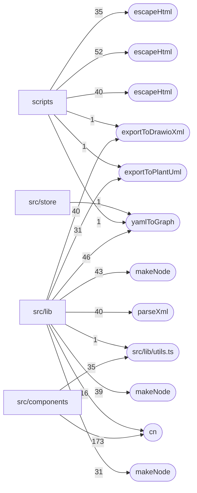

# Dependencies and hotspots — aacod

Derived from `code-graph/code-graph.jsonl` and `code-graph/metrics.json`. Hotspots are fan-in counts only (calls, renders, imports and links into a node); the bundle pins one commit, so there is no churn signal.

## External dependencies

| Package | Files that import or declare it |
|---|---:|
| `react` | 41 |
| `lucide-react` | 40 |
| `node:path` | 38 |
| `node:fs` | 30 |
| `js-yaml` | 25 |
| `@xyflow/react` | 22 |
| `@modelcontextprotocol/sdk` | 16 |
| `framer-motion` | 15 |
| `next` | 13 |
| `node:url` | 12 |
| `ajv` | 8 |
| `ajv-formats` | 8 |
| `zod` | 8 |
| `node:os` | 7 |
| `@base-ui/react` | 6 |
| `next-themes` | 5 |
| `plantuml-encoder` | 4 |
| `@types/js-yaml` | 3 |
| `@types/node` | 3 |
| `chalk` | 3 |
| `class-variance-authority` | 3 |
| `commander` | 3 |
| `typescript` | 3 |
| `vitest` | 3 |
| `@dagrejs/dagre` | 2 |
| `@monaco-editor/react` | 2 |
| `@vitejs/plugin-react` | 2 |
| `clsx` | 2 |
| `eslint` | 2 |
| `eslint-config-next` | 2 |

## Entry points

- `mcp-server/bin/aac-mcp.ts (cli-main)`
- `mcp-server/src/tools/lint-compliance.ts (mcp-tool)`
- `mcp-server/src/tools/scaffold-waiver.ts (mcp-tool)`
- `mcp-server/src/tools/validate-architecture.ts (mcp-tool)`
- `packages/policies/scripts/build-bundle.sh (cli-main)`
- `src/app/dashboard/page.tsx (next-route)`
- `src/app/error.tsx (next-route)`
- `src/app/layout.tsx (next-route)`
- `src/app/not-found.tsx (next-route)`
- `src/app/page.tsx (next-route)`
- `src/app/systems/[id]/page.tsx (next-route)`

## Fan-in hotspots

| Node | Fan-in |
|---|---:|
| `src/lib/utils.ts::cn` | 189 |
| `scripts/build-standard-pages.ts::escapeHtml` | 52 |
| `src/lib/parser/yaml-to-graph.ts::yamlToGraph` | 48 |
| `src/lib/export/drawio-export.test.ts::makeNode` | 43 |
| `src/lib/export/drawio-export.ts::exportToDrawioXml` | 41 |
| `scripts/build-waiver-pages.ts::escapeHtml` | 40 |
| `src/lib/export/drawio-export.test.ts::parseXml` | 40 |
| `src/lib/export/plantuml-export.test.ts::makeNode` | 39 |
| `src/lib/utils.ts` | 36 |
| `scripts/build-pattern-pages.ts::escapeHtml` | 35 |
| `src/lib/export/plantuml-export.ts::exportToPlantUml` | 32 |
| `src/lib/layout/dagre-layout.test.ts::makeNode` | 31 |
