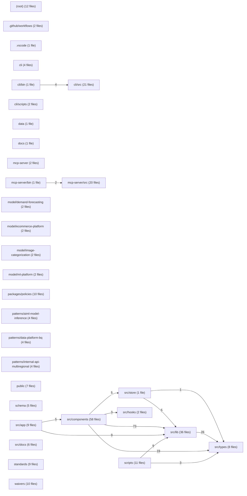

# Module view — aacod

Derived from `code-graph/code-graph.jsonl`; regenerated by the bundle builder and verified by reproduction (gate G11). Directories are aggregated to two path segments; at most 50 directories and 150 edges are drawn.

| Directory | Files | Symbols | Outgoing deps | Incoming deps |
|---|---:|---:|---:|---:|
| `(root)` | 12 | 0 | 0 | 0 |
| `.github/workflows` | 2 | 0 | 0 | 0 |
| `.vscode` | 1 | 0 | 0 | 0 |
| `cli` | 4 | 0 | 0 | 0 |
| `cli/bin` | 1 | 0 | 4 | 0 |
| `cli/scripts` | 2 | 0 | 0 | 0 |
| `cli/src` | 21 | 49 | 0 | 4 |
| `data` | 1 | 0 | 0 | 0 |
| `docs` | 1 | 0 | 0 | 0 |
| `mcp-server` | 2 | 0 | 0 | 0 |
| `mcp-server/bin` | 1 | 1 | 2 | 0 |
| `mcp-server/src` | 20 | 70 | 0 | 2 |
| `model/demand-forecasting` | 2 | 0 | 0 | 0 |
| `model/ecommerce-platform` | 2 | 0 | 0 | 0 |
| `model/image-categorization` | 2 | 0 | 0 | 0 |
| `model/ml-platform` | 2 | 0 | 0 | 0 |
| `packages/policies` | 10 | 0 | 0 | 0 |
| `patterns/aiml-model-inference` | 4 | 0 | 0 | 0 |
| `patterns/data-platform-bq` | 4 | 0 | 0 | 0 |
| `patterns/internal-api-multiregional` | 4 | 0 | 0 | 0 |
| `public` | 7 | 0 | 0 | 0 |
| `schema` | 5 | 0 | 0 | 0 |
| `scripts` | 11 | 152 | 12 | 0 |
| `src/app` | 9 | 8 | 14 | 0 |
| `src/components` | 58 | 194 | 100 | 5 |
| `src/docs` | 6 | 0 | 0 | 0 |
| `src/hooks` | 2 | 5 | 0 | 3 |
| `src/lib` | 36 | 107 | 26 | 96 |
| `src/store` | 1 | 2 | 6 | 5 |
| `src/types` | 8 | 68 | 0 | 49 |
| `standards` | 9 | 0 | 0 | 0 |
| `waivers` | 10 | 0 | 0 | 0 |
