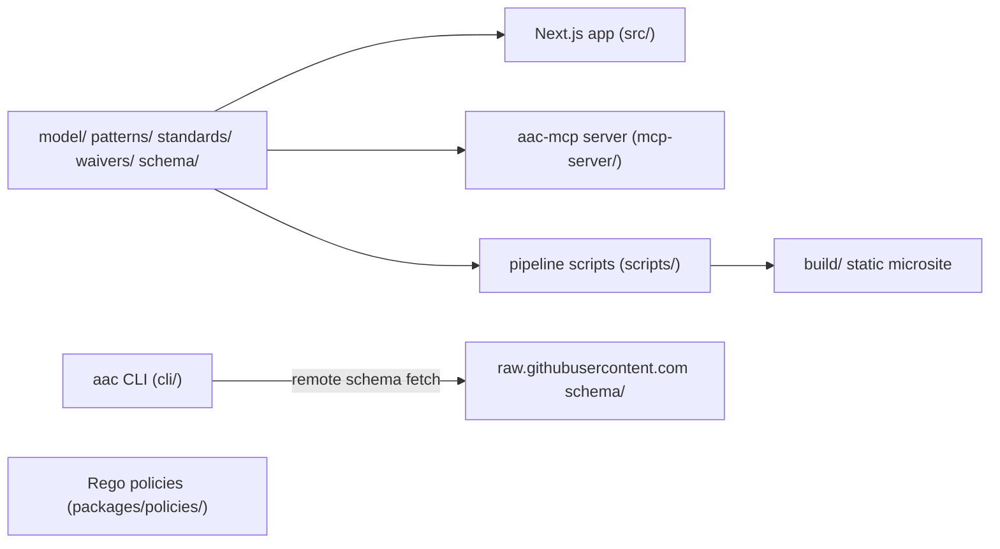

# Application architecture — Architecture as Code

## Components

The repository is one npm workspace root containing a Next.js app (`src/`), two separately published packages (`cli/` and `mcp-server/`), an OPA policy package (`packages/policies/`) and pipeline scripts (`scripts/`). All of them read the YAML folders at the repository root.[^agents-structure][^policies-readme-tree]

| Component | Main modules | Responsibility |
|---|---|---|
| Web app | `src/app`, `src/components`, `src/lib`, `src/store` | Landing scorecard, catalog dashboard, diagram editor [^agents-structure] |
| CLI | `cli/bin/aac.ts`, `cli/src/commands/*` | Scaffold and schema-validate artifacts [^cli-program] |
| MCP server | `mcp-server/src/{resources,tools,prompts}` | Expose repository content and checks to agents [^mcp-server-factory] |
| Pipeline scripts | `scripts/*.ts` | Validate, lint, generate diagrams and HTML catalog pages [^pkg-scripts] |
| Policies | `packages/policies/rules/*` | Rego deny rules for security, integration, FinOps [^policies-readme-domains] |

## Web app

There are three routes: `/` renders the landing scorecard, `/dashboard` renders the catalogs and `/systems/[id]` renders the diagram editor. Each is a server component that reads YAML from disk with `node:fs` at render time.[^readme-routes][^dashboard-page][^system-page]

Most UI and route code depends on the pure-logic modules in `src/lib`. In the code graph, `src/lib/utils.ts` is the internal file with the most importers.[^g-lib-utils]

Each loader works differently. `loadSystems` validates each `model/<dir>` pair with Zod and throws on bad data. `loadWaivers` parses every waiver YAML and casts it to the TypeScript type without running a schema check.[^load-systems][^load-systems-throw][^load-waivers]

The editor workspace puts a Monaco YAML pane next to a React Flow canvas in resizable panels, and seeds the shared Zustand store with the system's YAML on mount.[^workspace-init][^g-workspace]

## Bidirectional sync flow

On the YAML-to-canvas path, the editor debounces input by 300 ms and calls `updateFromYaml`. That runs schema validation, then `yamlToGraph`, then `applyDagreLayout`, and replaces the store's nodes and edges.[^editor-debounce][^store-from-yaml]

On the canvas-to-YAML path, a node drag-stop or a new connection calls `updateFromCanvas`, which regenerates the YAML text with `graphToYaml`.[^canvas-dragstop][^store-on-connect][^store-from-canvas]

A `syncSource` flag on the store stops loops: each direction returns early while the other is writing.[^store-from-yaml][^store-from-canvas]

`yamlToGraph` accepts two dialects. A document with a top-level `model` key (the current schema) is first converted to the legacy map-keyed `actors`/`softwareSystems` form by `transformNewToOld`. Its deployment nodes are added to the graph separately.[^yaml-to-graph][^new-to-old]

`graphToYaml` only writes the legacy map-keyed form, and it drops deployment and infrastructure edges as read-only.[^graph-to-yaml][^graph-to-yaml-deploy]

*Assessment:* The canvas-to-YAML direction is lossy for current-format models. A single drag on a `model:`-style system rewrites the editor text into the legacy dialect, without `views`, `deploymentNodes` or container `properties`. Nothing is persisted (none of the routes accepts writes), so the risk is to what users copy out of the editor, not to the repository.[^graph-to-yaml][^yaml-to-graph][^store-from-canvas][^readme-routes]

Exports run from the same graph. The toolbar downloads Draw.io XML in the browser. The pipeline's `build-diagrams.ts` builds PlantUML and Draw.io files for every system and view, using the web app's own parser, view filter, layout and exporters under a jsdom shim.[^toolbar-drawio][^build-diagrams-imports]

## CLI

`aac` is a Commander program with three commands: `init`, `create <type> [name]`, and `validate <filepath>` with `--type`, `--output` and `--force-refresh` options.[^cli-program]

`validate` infers the schema type from the first matching path segment (`model`, `patterns`, `standards`, `waivers`). It walks directories for `.yaml`, `.yml` and `.json` files and skips `metadata.json`.[^cli-infer][^cli-expand]

## MCP server

The `aac-mcp` binary resolves the repository root from `--root`, or by walking up from the working directory until it finds `schema/` and `model/`. It then connects an `McpServer` to a stdio transport.[^mcp-main][^repo-root]

The server registers five resource groups (systems, standards, waivers, patterns, schemas), three tools and two prompts.[^mcp-server-factory][^mcp-resources-index][^mcp-tools-index]

| MCP tool | Behavior | Writes? |
|---|---|---|
| `validate_architecture` | AJV-validates supplied YAML; auto-detects type when omitted [^tool-validate-def] | No (`readOnlyHint`) [^tool-validate-def] |
| `lint_compliance` | Runs the five structural rules over `model/*/system.yaml` or one `systemId` [^tool-lint-def] | No (`readOnlyHint`) [^tool-lint-def] |
| `scaffold_waiver` | Builds a `PENDING_REVIEW` waiver, validates it and writes `waivers/<slug>.yaml` [^tool-waiver-write] | Yes [^tool-waiver-write] |

Auto-detection only checks top-level keys (`model`, `standardId`, `exceptionId`, `patternId` and snake_case variants). Standards nest their ID under `metadata.standardId` and patterns nest theirs under `pattern.id`.[^detect-type][^std-yaml-head][^pattern-yaml-head]

*Assessment:* So auto-detection works for systems and waivers but not for this repository's own standards or patterns. Agents must pass `type` explicitly for those.[^detect-type][^std-yaml-head][^pattern-yaml-head]

The five compliance rules exist twice, once in `scripts/lint-architecture.ts` and once in `mcp-server/src/tools/lint-compliance.ts`. Each copy has its own type definitions and keyword lists.[^g-lint-script-rule1][^g-lint-mcp-rule1]

*Assessment:* The duplicated rule code can drift. A rule change merged into the pipeline linter will not reach agents until someone mirrors it in the MCP tool.[^g-lint-script-rule1][^g-lint-mcp-rule1]

[^agents-structure]: src · AGENTS.md#L14-L28 · sha256:3538a5b36f72135d4cd4726b583ddb9f6b77bf988da470b53b4ec2b9fba51de8
[^policies-readme-tree]: src · packages/policies/README.md#L20-L36 · sha256:3f6403378b27455368f139e294caf49172d166549781b046e466388810f765f1
[^cli-program]: src · cli/bin/aac.ts#L11-L48 · sha256:ba0ac72e5a41e41f4ad7b2d9eaab5df2e0a5dfd371d14ba7fd385be0bf930fda
[^mcp-server-factory]: src · mcp-server/src/server.ts#L14-L42 · sha256:32dab21fba60dd5a07f9731db620eb56c534227bc7391e31b6b510b49394ca11
[^pkg-scripts]: src · package.json#L5-L26 · sha256:d5481d203a48c97723ff6b99314a5eb7f967422fb04bd1e5c691fa4bcc240348
[^policies-readme-domains]: src · packages/policies/README.md#L48-L60 · sha256:a8e74072f5c9c687bd1e8b7b82de92d9547436e2ed1ad95c4bdcd3d9e7526717
[^readme-routes]: src · README.md#L516-L526 · sha256:2adc0b33a579c9e0faf5eaa3ec94c3e678c6560e122f53d942206a0296d03695
[^dashboard-page]: src · src/app/dashboard/page.tsx#L18-L27 · sha256:967399e5f096a0bb7f8ee42ba78c11fb9e14cc9509f8b1f3d812a9dd6a585077
[^system-page]: src · src/app/systems/[id]/page.tsx#L5-L18 · sha256:e4c30566385b2fde8f5bb2ae35dc5d952010b0fae787d637f051f71090bd2924
[^g-lib-utils]: graph · src/lib/utils.ts
[^load-systems]: src · src/lib/model/load-systems.ts#L14-L52 · sha256:8409ff9a4520cfeea3c1c7c9f6c1632f86b90332b33ee1d7060d30579f75fb0c
[^load-systems-throw]: src · src/lib/model/load-systems.ts#L147-L156 · sha256:767fe69c53b343ad316f0b2cac9e55ed53636235c057a8b5cbe48c63a2b006cc
[^load-waivers]: src · src/lib/model/load-waivers.ts#L12-L37 · sha256:e2c8eecb49547a23844f3e22be6a87cbe560a2cdc7b7266c20397b5ed61d2725
[^workspace-init]: src · src/components/diagram-workspace.tsx#L25-L56 · sha256:8d85456204353de07d48a698c293be110a2be718fd9ca8aed57beb2982c67d97
[^g-workspace]: graph · src/components/diagram-workspace.tsx::DiagramWorkspace
[^editor-debounce]: src · src/components/editor/editor-pane.tsx#L17-L34 · sha256:961d12ab06d5bbaaa44dd6c5d42e06b9df85840078b8e298d251a8896ba5114a
[^store-from-yaml]: src · src/store/use-graph-store.ts#L86-L127 · sha256:78766c19b62ab238863bca30c0e63ceaf2424c1b33a2cf1cbb30e8eeb55b6ad3
[^canvas-dragstop]: src · src/components/canvas/canvas-pane.tsx#L38-L63 · sha256:9008d0dcfc4d836df81618cc99d22a71fabec22003efbfd5b5a0fa20139a5fb6
[^store-on-connect]: src · src/store/use-graph-store.ts#L70-L84 · sha256:07b836e2e02c6d8bc20aa532d37071e3a43055374a4275a8c9a7bf13efb16290
[^store-from-canvas]: src · src/store/use-graph-store.ts#L129-L136 · sha256:5b86aa824015b1b2d6729822a7b132af4e25f0d2d35707f02189a2d2427a3c5c
[^yaml-to-graph]: src · src/lib/parser/yaml-to-graph.ts#L18-L46 · sha256:1b1ee0fcd03fe9ca51ab50892fbf0262182ffb8447e0823c8c4b09a1c57b497d
[^new-to-old]: src · src/lib/parser/new-to-old-transform.ts#L75-L79 · sha256:2e4b42febe86b5ffc873433d5585901d085ecb31a3965874be66dd852a1c74ec
[^graph-to-yaml]: src · src/lib/parser/graph-to-yaml.ts#L12-L43 · sha256:8498e3b72c3a5d8e7d401d1043ac6216ba498ff5776586351efc35323477f6f6
[^graph-to-yaml-deploy]: src · src/lib/parser/graph-to-yaml.ts#L77-L81 · sha256:e6a6d5ab4fb2de435c1aea505f1ae386a2052cc5aad089a774f2341d0be3719f
[^toolbar-drawio]: src · src/components/toolbar/app-toolbar.tsx#L103-L114 · sha256:bf4a0cb7635c195f57adad1ec0fbc524fda4839c680a1d5d56e5af059244bc8d
[^build-diagrams-imports]: src · scripts/build-diagrams.ts#L1-L32 · sha256:5db9592b35765ac866391ee0cd8dd3b2bfaf309fac42028a7dc1a3441e1f89ba
[^cli-infer]: src · cli/src/commands/validate.ts#L19-L32 · sha256:31f0ab9eaa630772c3c92ca63065a1ae01af3e5069f50c2e52736880ba3c3b67
[^cli-expand]: src · cli/src/commands/validate.ts#L35-L60 · sha256:56321880cfd58e768028eb712b858661940def0705a715da689942dbc121e629
[^mcp-main]: src · mcp-server/bin/aac-mcp.ts#L7-L23 · sha256:d701f7215b5b5349d5e4a8f99169b8c171e74e8dc1f0a5aa409ffff30e7581ff
[^repo-root]: src · mcp-server/src/lib/repo-resolver.ts#L12-L38 · sha256:65a2e7a49c5c91e7d7c7ae641b394f0e7fdf63c9d43030b8452f7b4a97acd5d0
[^mcp-resources-index]: src · mcp-server/src/resources/index.ts#L13-L19 · sha256:4c3272b301f4b0bdf9973be57676b695c6ac5dc5e04eb227ea891f73fdc4179f
[^mcp-tools-index]: src · mcp-server/src/tools/index.ts#L11-L15 · sha256:7f2d7843d0f6191b0926e5c917cf26b7c2eaa704c114e6d10556c13a895140eb
[^tool-validate-def]: src · mcp-server/src/tools/validate-architecture.ts#L24-L44 · sha256:7d03c865708708e0d73807f2f19adb43c0b86347a1495bd737a6ebebd41d2b19
[^tool-lint-def]: src · mcp-server/src/tools/lint-compliance.ts#L422-L453 · sha256:81529c96419550532d0bc72dd9e3e6703915dfc86895876057e57383a76aa77e
[^tool-waiver-write]: src · mcp-server/src/tools/scaffold-waiver.ts#L130-L165 · sha256:3e9f909b06bb4538c4914c1744e0a5d75cd09e15526cd9109654d68979c2f896
[^detect-type]: src · mcp-server/src/lib/validator.ts#L93-L110 · sha256:38af33c0bd3c28fa8949babd2e556d4e922d54eacc85d803c1f926580ad11f11
[^std-yaml-head]: src · standards/cryptography-key-management.yaml#L1-L4 · sha256:b0ce46895d7db5e8856978c792062f297c212c81b31e998d3d5df2d96859ff2e
[^pattern-yaml-head]: src · patterns/data-platform-bq/pattern.yaml#L1-L4 · sha256:0dc7872d66c14934d4d2e50ea56cb05a123e967fabafcd9adacb1c52f9311154
[^g-lint-script-rule1]: graph · scripts/lint-architecture.ts::checkNoFrontendDbBypass
[^g-lint-mcp-rule1]: graph · mcp-server/src/tools/lint-compliance.ts::checkNoFrontendDbBypass
