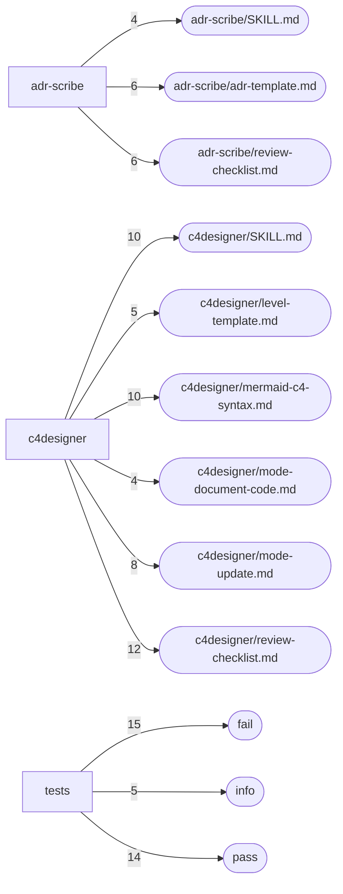

# Dependencies and hotspots — cfskl

Derived from `code-graph/code-graph.jsonl` and `code-graph/metrics.json`. Hotspots are fan-in counts only (calls, renders, imports and links into a node); the bundle pins one commit, so there is no churn signal.

## External dependencies

| Package | Files that import or declare it |
|---|---:|
| `react` | 4 |
| `express` | 2 |
| `pg` | 2 |
| `prism-react-renderer` | 2 |
| `react-dom` | 2 |
| `` | 1 |
| `@docusaurus/ComponentCreator` | 1 |
| `@docusaurus/core` | 1 |
| `@docusaurus/module-type-aliases` | 1 |
| `@docusaurus/preset-classic` | 1 |
| `@docusaurus/theme-mermaid` | 1 |
| `@docusaurus/types` | 1 |
| `@generated/docusaurus-plugin-content-docs` | 1 |
| `@mdx-js/react` | 1 |
| `@site/docs` | 1 |
| `@theme/DocItem` | 1 |
| `@theme/DocRoot` | 1 |
| `@theme/DocVersionRoot` | 1 |
| `@theme/DocsRoot` | 1 |
| `clsx` | 1 |

## Entry points

- `install.sh (cli-main)`
- `tests/test-skill-format.sh (cli-main)`
- `tests/validate-adr.sh (cli-main)`
- `tests/validate-c4-diagram.sh (cli-main)`

## Fan-in hotspots

| Node | Fan-in |
|---|---:|
| `tests/test-skill-format.sh::fail` | 15 |
| `tests/test-skill-format.sh::pass` | 14 |
| `c4designer/review-checklist.md` | 12 |
| `c4designer/SKILL.md` | 10 |
| `c4designer/mermaid-c4-syntax.md` | 10 |
| `c4designer/mode-update.md` | 8 |
| `adr-scribe/adr-template.md` | 6 |
| `adr-scribe/review-checklist.md` | 6 |
| `c4designer/level-template.md` | 5 |
| `tests/test-skill-format.sh::info` | 5 |
| `adr-scribe/SKILL.md` | 4 |
| `c4designer/mode-document-code.md` | 4 |
