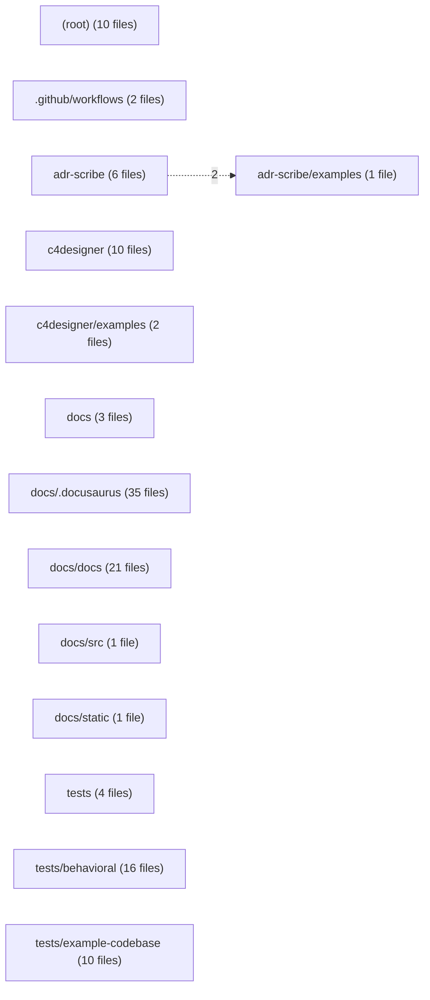

# Module view — cfskl

Derived from `code-graph/code-graph.jsonl`; regenerated by the bundle builder and verified by reproduction (gate G11). Directories are aggregated to two path segments; at most 50 directories and 150 edges are drawn.

| Directory | Files | Symbols | Outgoing deps | Incoming deps |
|---|---:|---:|---:|---:|
| `(root)` | 10 | 0 | 0 | 0 |
| `.github/workflows` | 2 | 0 | 0 | 0 |
| `adr-scribe` | 6 | 0 | 2 | 0 |
| `adr-scribe/examples` | 1 | 0 | 0 | 2 |
| `c4designer` | 10 | 0 | 0 | 0 |
| `c4designer/examples` | 2 | 0 | 0 | 0 |
| `docs` | 3 | 0 | 0 | 0 |
| `docs/.docusaurus` | 35 | 0 | 0 | 0 |
| `docs/docs` | 21 | 0 | 0 | 0 |
| `docs/src` | 1 | 0 | 0 | 0 |
| `docs/static` | 1 | 0 | 0 | 0 |
| `tests` | 4 | 4 | 0 | 0 |
| `tests/behavioral` | 16 | 0 | 0 | 0 |
| `tests/example-codebase` | 10 | 2 | 0 | 0 |
