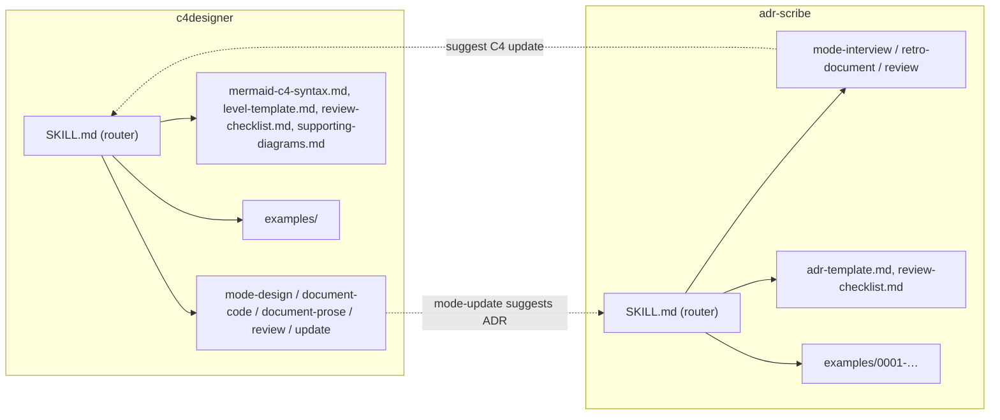

# Application architecture — C4 skills

For this application the "components" are skill folders and the files inside them; the runtime is whichever AI agent loads them.[^contrib-structure][^security-safe]

## Skill folder layout

Each skill sits in its own top-level directory with a `SKILL.md` entry file; contributors are told to split multiple modes into separate `mode-*.md` files and to ship an `examples/` directory.[^contrib-structure]

| Folder | Files | Role |
|---|---|---|
| `c4designer/` | `SKILL.md`, five `mode-*.md`, `mermaid-c4-syntax.md`, `level-template.md`, `review-checklist.md`, `supporting-diagrams.md`, `examples/` | C4 diagram skill [^c4-refs] |
| `adr-scribe/` | `SKILL.md`, three `mode-*.md`, `adr-template.md`, `review-checklist.md`, `examples/0001-use-postgresql-over-mongodb.md` | ADR skill [^adr-refs] |

## SKILL.md as a router

Each `SKILL.md` opens with YAML frontmatter carrying `name`, `version`, `requires`, `compatible_agents` and a `description` that tells the agent when to trigger the skill.[^c4-fm][^adr-fm]

The body of `c4designer/SKILL.md` instructs the agent to identify the mode first, lists signals for inferring it without asking, and maps each mode to the one file the agent must read next.[^c4-router]

`adr-scribe/SKILL.md` follows the same pattern with three modes and its own signal table.[^adr-router]

*Assessment:* Progressive loading keeps the entry file small enough to sit in context while mode detail is read only on demand; the cost is that correctness depends on the agent following the "read this file next" instruction.[^c4-router][^adr-router]

The code graph confirms the hub shape: `c4designer/SKILL.md` has the highest outgoing link weight of any skill file, and `c4designer/review-checklist.md` has the highest incoming link weight of any document, because the router and the mode files point to it before delivery.[^g-c4skill][^g-c4check]

## Common contract

`c4designer/SKILL.md` defines a contract shared by all modes: default output of one Markdown document per level with embedded Mermaid C4, a negotiated destination (local `docs/architecture/` by default), non-negotiable notation rules, and a per-level document structure taken from `level-template.md`.[^c4-contract]

Dialogue rules cap questions at five per batch for `c4designer` and three for `adr-scribe`, and both forbid writing a final file before the user validates the draft.[^c4-dialogue][^adr-dialogue]

## Cross-skill links

`c4designer/mode-update.md` tells the agent to offer an ADR through `adr-scribe` when a change adds a major structural element such as a database or queue.[^update-xskill]

The `adr-scribe` interview and retro-document modes close the loop by offering to update the C4 diagrams with `c4designer`.[^interview-xskill][^retro-xskill]

`registry.json` records the dependency formally: `adr-scribe` requires `c4-model >= 1.0.0`, which is the frontmatter `name` of the skill whose folder and registry id are `c4designer`.[^registry][^c4-fm]

*Assessment:* The dependency is expressed against the skill name while the registry, test runner and installer key on the folder id, so any future resolver must map `c4-model` to `c4designer` explicitly.[^registry][^c4-fm]

## Install mechanics

The README installs a skill by copying its folder into the agent's discovery directory: `.github/skills/` for Copilot, `.agents/skills/` for Devin, Cursor, Windsurf and Antigravity, and `.claude/skills/` for Claude Code.[^readme-install]

`install.sh` defines targets for Copilot, Devin, Claude and Cursor, but picks only one: `.github/skills` when a `.github` folder exists, otherwise `.agents/skills`; it then copies both skill folders there.[^install-targets][^install-loop]

*Assessment:* The installer never writes to `.claude/skills` even though it defines that path, so Claude Code users must still copy the folders by hand as the README describes.[^install-targets][^readme-install]

`make install` runs `install.sh`, and `make test` and `make lint` both run the test runner.[^makefile]

## Test suite

`tests/test-skill-format.sh` is the single entry point and runs four suites: frontmatter structure for every `*/SKILL.md`, golden sandbox diagrams, behavioral fixtures, and registry completeness.[^g-runner][^suite1][^suite4]

| Suite | What it checks | Evidence |
|---|---|---|
| 1 Structure | Frontmatter fences and the `name`, `description`, `version`, `requires`, `compatible_agents` keys via `grep`; validates each skill's `examples/` with the matching validator | [^suite1] |
| 2 Sandbox | Every `tests/example-codebase/diagrams/*.md` passes `validate-c4-diagram.sh` | [^suite2] |
| 3 Behavioral | Each fixture has `prompt.md` with `## Acceptance Criteria` and an `expected.md` that passes (or, for `negative-*`, fails) the validator named in `skill.txt` | [^suite3] |
| 4 Registry | Every skill folder appears as an `id` in `registry.json` and the registry version equals the `c4designer` frontmatter version | [^suite4] |

`validate-c4-diagram.sh` requires a Mermaid block, a C4 diagram type and a title; it rejects bare "Uses"/"Calls"/"Reads" labels, `{` appended to `System` or `Container`, containers without a technology, relationships without a protocol, and relationships to undefined aliases.[^c4-validator]

`validate-adr.sh` requires a `* Status:` line and the `## Context`, `## Considered Options`, `## Decision Outcome` and `### Negative Consequences` headings.[^adr-validator]

The fixture README says each fixture holds a `README.md`, but the runner reads `skill.txt` for routing and the fixtures ship `prompt.md`, `expected.md` and `skill.txt`.[^behavioral-readme][^suite3]

*Assessment:* The behavioral suite checks only that hand-written golden outputs are internally valid; it never runs an agent, which the fixture README acknowledges by requiring human review of real responses.[^suite3][^behavioral-readme]

[^contrib-structure]: src · CONTRIBUTING.md#L15-L32 · sha256:75df72f28f7a1a00d6fa5545dd38dd2d52179e3b43d537fc15885cdd0be3165c
[^security-safe]: src · SECURITY.md#L11-L17 · sha256:42ec0f46c9903d5f97069c5bc367e4bb2cdc2396d55412e174c0ed9fb252d1f5
[^c4-refs]: src · c4designer/SKILL.md#L237-L253 · sha256:a6d5c5b00ea6cd753d392c25f7451d7dc0ebed81aa144c095344e1dea92e48ed
[^adr-refs]: src · adr-scribe/SKILL.md#L71-L83 · sha256:8ef07dfdaefb4a856b6be261e2e0437755fb8a594b6a4f54d44a4566e2d30b08
[^c4-fm]: src · c4designer/SKILL.md#L1-L7 · sha256:f99980a6759e1a47ba85e979e6cf288ba5291785eb83b79a2b06837b19dfe3e1
[^adr-fm]: src · adr-scribe/SKILL.md#L1-L7 · sha256:089040b8f76d836f1f67f55f659eb5a2829d3e6eebbba8fda4b69aa41281616d
[^c4-router]: src · c4designer/SKILL.md#L26-L55 · sha256:078f820837830a6f282c2fe094dccc4d2d9c8881fc6e2872c23f47a141034bdf
[^adr-router]: src · adr-scribe/SKILL.md#L13-L36 · sha256:80de2ac0c59d99413d3043eb0b877c43c8cfcf445fc40fb81c11e074c929da5f
[^g-c4skill]: graph · c4designer/SKILL.md
[^g-c4check]: graph · c4designer/review-checklist.md
[^c4-contract]: src · c4designer/SKILL.md#L57-L128 · sha256:ef1d2b774679446d1004b936e0a07782a30860052d7304a6fe915b0387db18fa
[^c4-dialogue]: src · c4designer/SKILL.md#L134-L142 · sha256:9d707b2a53b75ebca2827a231b617523a7519c332de68a2b19c7309faa3d5caa
[^adr-dialogue]: src · adr-scribe/SKILL.md#L56-L62 · sha256:53d52e3bc1fea98695afe145d3ac62b4a5366cd2e881043da99ccde7ecdb8194
[^update-xskill]: src · c4designer/mode-update.md#L49-L49 · sha256:6db3a6801b38940c05d3660410a6348c0145c362107a69e28aef43d0e1a83666
[^interview-xskill]: src · adr-scribe/mode-interview.md#L52-L52 · sha256:53cb3118321531edfc8292f67dc3c5d532fc43bea65dcbba4aa289b74c627edb
[^retro-xskill]: src · adr-scribe/mode-retro-document.md#L36-L36 · sha256:b4df9d99814617266c12d57c48fe08042f131f702a55565d03f5fe75ed4da548
[^registry]: src · registry.json#L5-L36 · sha256:363eb074f0dcd535ed2be5aad9d606cc258eefd50ba8623efa504687e7df1127
[^readme-install]: src · README.md#L97-L133 · sha256:cafd8aecd539fefc5658303e8653bf204c243043c0059f46fd9199c0d31b4296
[^install-targets]: src · install.sh#L9-L28 · sha256:7981634c9373e082163af4f78719856ba4366dfa06008ee32541e7bfd7c36623
[^install-loop]: src · install.sh#L30-L36 · sha256:519f2cc94f1c054156473570cd8f80b67f124c2d0ce16cfd8f3aa17dd93feed2
[^makefile]: src · Makefile#L1-L16 · sha256:3e231fb09b7c2a31c102fc9f2b3d051f20f20a325046e1669c963bb27485d198
[^g-runner]: graph · tests/test-skill-format.sh
[^suite1]: src · tests/test-skill-format.sh#L52-L135 · sha256:3d3c7b20b8642b7da830ad6212680565284779bc52813eee4cbb7461a9fb8550
[^suite2]: src · tests/test-skill-format.sh#L140-L157 · sha256:5a4c5fbea98521a14609e54df93392c40123a135f212370c9a4ce6ce10b40b30
[^suite3]: src · tests/test-skill-format.sh#L162-L220 · sha256:7e914ca2507caaa82ed90137da1cfe9eb88b1038e7a66e2305d7970439781574
[^suite4]: src · tests/test-skill-format.sh#L225-L251 · sha256:e614a5d3af379c8f065b141fe72759d4d73fa5087e086e2ace878735d621837e
[^c4-validator]: src · tests/validate-c4-diagram.sh#L19-L80 · sha256:aee5768164af7267aa71e4606f13e3e17ed8c9734870b52c498db53459bbdc15
[^adr-validator]: src · tests/validate-adr.sh#L19-L47 · sha256:5a8bef5e410db5aa9d8c8db9efc34cfcf552702b04d2bdbcd77d99d07fe212c4
[^behavioral-readme]: src · tests/behavioral/README.md#L5-L13 · sha256:75c55ce3106a446f49c852d88de1c1804be5252ccc99a6c999bf3a16a28bad51
