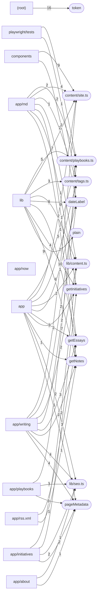

# Dependencies and hotspots — folio

Derived from `code-graph/code-graph.jsonl` and `code-graph/metrics.json`. Hotspots are fan-in counts only (calls, renders, imports and links into a node); the bundle pins one commit, so there is no churn signal.

## External dependencies

| Package | Files that import or declare it |
|---|---:|
| `next` | 26 |
| `react` | 13 |
| `@playwright/test` | 5 |
| `next-themes` | 3 |
| `@vercel/analytics` | 2 |
| `@vercel/speed-insights` | 2 |
| `clsx` | 2 |
| `node:child_process` | 2 |
| `node:fs` | 2 |
| `node:path` | 2 |
| `tailwind-merge` | 2 |
| `tailwindcss` | 2 |
| `@hookform/resolvers` | 1 |
| `@radix-ui/react-accordion` | 1 |
| `@radix-ui/react-alert-dialog` | 1 |
| `@radix-ui/react-aspect-ratio` | 1 |
| `@radix-ui/react-avatar` | 1 |
| `@radix-ui/react-checkbox` | 1 |
| `@radix-ui/react-collapsible` | 1 |
| `@radix-ui/react-context-menu` | 1 |
| `@radix-ui/react-dialog` | 1 |
| `@radix-ui/react-dropdown-menu` | 1 |
| `@radix-ui/react-hover-card` | 1 |
| `@radix-ui/react-label` | 1 |
| `@radix-ui/react-menubar` | 1 |
| `@radix-ui/react-navigation-menu` | 1 |
| `@radix-ui/react-popover` | 1 |
| `@radix-ui/react-progress` | 1 |
| `@radix-ui/react-radio-group` | 1 |
| `@radix-ui/react-scroll-area` | 1 |

## Entry points

- `.github/ci-run.sh (cli-main)`
- `app/about/page.tsx (next-route)`
- `app/error.tsx (next-route)`
- `app/initiatives/[slug]/page.tsx (next-route)`
- `app/initiatives/page.tsx (next-route)`
- `app/layout.tsx (next-route)`
- `app/llms.txt/route.ts (next-route)`
- `app/md/[[...path]]/route.ts (next-route)`
- `app/not-found.tsx (next-route)`
- `app/now/page.tsx (next-route)`
- `app/page.tsx (next-route)`
- `app/playbooks/[slug]/assessment/page.tsx (next-route)`
- `app/playbooks/[slug]/page.tsx (next-route)`
- `app/playbooks/page.tsx (next-route)`
- `app/reach/page.tsx (next-route)`
- `app/rss.xml/route.ts (next-route)`
- `app/search-index.json/route.ts (next-route)`
- `app/search/page.tsx (next-route)`
- `app/writing/[slug]/page.tsx (next-route)`
- `app/writing/page.tsx (next-route)`
- `app/writing/tag/[tag]/page.tsx (next-route)`
- `app/writing/theme/[theme]/page.tsx (next-route)`
- `scripts/check-links.mjs (cli-main)`
- `scripts/check-public-content.mjs (cli-main)`
- `scripts/og/make-images.py (cli-main)`

## Fan-in hotspots

| Node | Fan-in |
|---|---:|
| `content/site.ts` | 41 |
| `content/playbooks.ts` | 23 |
| `lib/content.ts::getEssays` | 19 |
| `tailwind.config.ts::token` | 16 |
| `lib/seo.ts` | 15 |
| `lib/seo.ts::pageMetadata` | 14 |
| `lib/content.ts::dateLabel` | 13 |
| `lib/content.ts` | 11 |
| `lib/content.ts::getNotes` | 11 |
| `content/tags.ts` | 10 |
| `lib/content.ts::getInitiatives` | 10 |
| `lib/search.ts::plain` | 9 |
