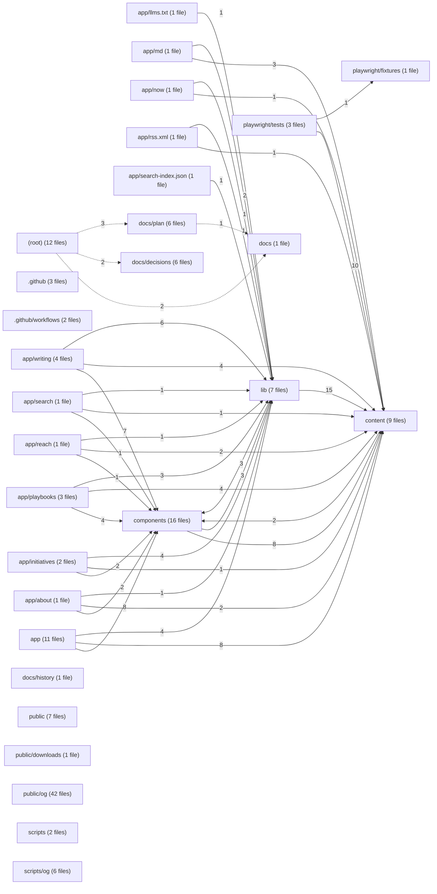

# Module view — folio

Derived from `code-graph/code-graph.jsonl`; regenerated by the bundle builder and verified by reproduction (gate G11). Directories are aggregated to two path segments; at most 50 directories and 150 edges are drawn.

| Directory | Files | Symbols | Outgoing deps | Incoming deps |
|---|---:|---:|---:|---:|
| `(root)` | 12 | 4 | 7 | 0 |
| `.github` | 3 | 0 | 0 | 0 |
| `.github/workflows` | 2 | 0 | 0 | 0 |
| `app` | 11 | 9 | 20 | 0 |
| `app/about` | 1 | 1 | 5 | 0 |
| `app/initiatives` | 2 | 7 | 7 | 0 |
| `app/llms.txt` | 1 | 1 | 1 | 0 |
| `app/md` | 1 | 3 | 5 | 0 |
| `app/now` | 1 | 1 | 2 | 0 |
| `app/playbooks` | 3 | 10 | 11 | 0 |
| `app/reach` | 1 | 1 | 4 | 0 |
| `app/rss.xml` | 1 | 2 | 2 | 0 |
| `app/search` | 1 | 1 | 3 | 0 |
| `app/search-index.json` | 1 | 1 | 1 | 0 |
| `app/writing` | 4 | 14 | 17 | 0 |
| `components` | 16 | 57 | 11 | 30 |
| `content` | 9 | 12 | 2 | 60 |
| `docs` | 1 | 0 | 0 | 3 |
| `docs/decisions` | 6 | 0 | 0 | 2 |
| `docs/history` | 1 | 0 | 0 | 0 |
| `docs/plan` | 6 | 0 | 1 | 3 |
| `lib` | 7 | 45 | 18 | 29 |
| `playwright/fixtures` | 1 | 0 | 0 | 1 |
| `playwright/tests` | 3 | 5 | 11 | 0 |
| `public` | 7 | 0 | 0 | 0 |
| `public/downloads` | 1 | 0 | 0 | 0 |
| `public/og` | 42 | 0 | 0 | 0 |
| `scripts` | 2 | 5 | 0 | 0 |
| `scripts/og` | 6 | 13 | 0 | 0 |
