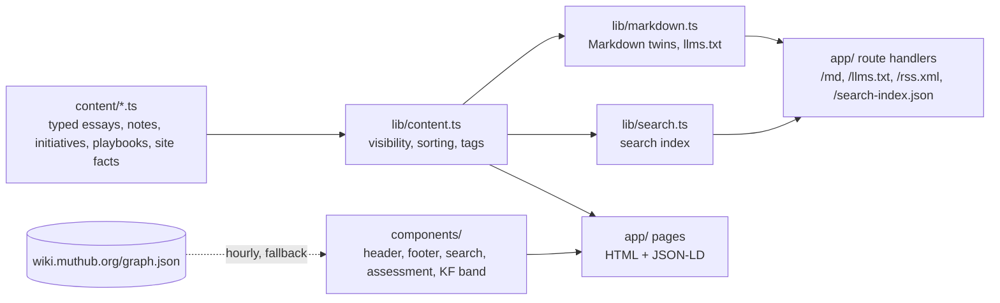

# Application architecture — Portfolio website (muthub.org)

## Layering

The code has three layers: typed content in `content/`, accessors and renderers in `lib/`, and Next.js pages, route handlers and components in `app/` and `components/`.[^readme-map]

`content/site.ts` is the highest fan-in node in the graph (41), followed by `content/playbooks.ts` and `lib/content.ts::getEssays`.[^g-site][^g-getessays]

*Assessment:* Almost every page and generator reads through the same few content accessors, so a change to a content type or to `getEssays` affects HTML, Markdown, RSS, sitemap and search together.[^g-site][^g-getessays]

## Components

| Module | Responsibility |
|---|---|
| `content/site.ts` | Site identity, navigation, the five themes and the shared `Block` type for rich text [^site-block] |
| `content/essays.ts`, `essays-more.ts`, `context-engineering.ts` | Essays and notes as typed objects with `status`, `published`, `updated`, `related`, `series` and a block body [^essay-type] |
| `content/initiatives.ts`, `content/playbooks.ts` | Case studies (problem, approach, governance, outcome, optional C4 levels) and checklists with a `reviewed` date [^initiative-type][^playbook-type] |
| `content/tags.ts` | Topic tags: a curated list per slug, else up to three regex matches on title and summary [^tags-for] |
| `lib/content.ts` | Merges content files, hides drafts in production, sorts by date, computes reading time and tag counts [^content-visible] |
| `lib/markdown.ts` | Renders every page type as Markdown and builds `/llms.txt` [^llms-txt] |
| `lib/search.ts` / `lib/search-score.ts` | Builds the static index on the server; ranks it in the browser [^search-build][^search-score] |
| `lib/seo.ts` | Canonical URL, Markdown alternate, Open Graph and X card per page [^seo-meta] |
| `components/json-ld.tsx` | Person, ProfilePage and WebSite (with SearchAction) structured data [^jsonld] |
| `components/knowledge-foundation-band.tsx` | Home-page band with counts read from the wiki's `graph.json` [^kf-band] |
| `components/assessment.tsx` | Client-side playbook self-assessment and score bands [^assess] |
| `components/figures.tsx` | Inline SVG architecture figures plus `figureMeta` alt text and captions reused by Markdown and search [^figures] |

## Entry points

The code graph records 21 Next.js route entry points under `app/` and four command-line entry points: `.github/ci-run.sh`, `scripts/check-links.mjs`, `scripts/check-public-content.mjs` and `scripts/og/make-images.py`.[^g-ci-run][^g-checklinks][^g-guard][^g-og]

Every dynamic page route sets `dynamicParams = false` and enumerates its slugs in `generateStaticParams`, so only known content renders and anything else is a 404.[^writing-params][^md-params]

## Key flows

### Draft to published page

`lib/content.ts` shows drafts in development or when `NEXT_PUBLIC_SHOW_DRAFTS=true`, and hides them in a production build until `status` is `published`.[^content-visible]

Essay pages emit an `Article` (essays) or `BlogPosting` (notes) record whose author is the shared Person schema and whose image is the per-piece social card when one exists.[^article-ld][^seo-image]

### Markdown twin request

`next.config.mjs` rewrites `/index.md`, `/<section>.md` and `/<section>/<slug>.md` to the catch-all `app/md/[[...path]]` route.[^next-rewrites]

The route's `render` function dispatches on the path segments to the matching `lib/markdown.ts` renderer and returns 404 for anything it does not know.[^md-render]

`blocksToMarkdown` turns each typed block into Markdown; figures become an italic line built from their alt text and caption.[^blocks-md]

### Search

`/search-index.json` is a static route that serializes `buildSearchIndex()` with a one-day CDN cache.[^search-route]

The index holds essays, notes, initiatives, one entry per C4 architecture level, playbooks and five fixed pages, with body text capped at 4,000 characters.[^search-build]

In the browser, `searchEntries` requires every query word to match and scores title hits above summary hits above body hits, plus a per-kind boost.[^search-score]

The dialog opens on Cmd/Ctrl+K anywhere and on `/` when focus is not in a text field.[^search-keys]

### Knowledge Foundation band

`wikiCounts` fetches `graph.json` with a 4-second timeout and hourly revalidation, applies the wiki's own counting rules, and returns fixed fallback counts on any failure.[^kf-band]

*Assessment:* The band is the only runtime dependency on another system, and it is fenced by a timeout and a fallback, so the rest of the site stays fully static.[^kf-band]

## Build-time generators outside Next.js

`scripts/og/make-images.py` reads slugs and titles out of the content files with regular expressions, relying on their JSON-shaped object literals, and writes one social card per piece.[^og-read]

*Assessment:* The social-card generator depends on the textual formatting of `content/*.ts`, not on its types; reformatting those files (for example unquoting keys) would silently drop cards rather than fail the build.[^og-read][^seo-image]

The footer's "Last updated" date is the latest commit time, read once in `next.config.mjs` and inlined as `SITE_UPDATED`, so hourly regeneration of the home page cannot change it.[^next-updated][^site-updated]

*Assessment:* Figure alt text and captions live in the same file as the SVG drawings, so the text renderers in `lib/` depend on a large presentational component to produce Markdown and search entries.[^figures][^blocks-md]

[^readme-map]: src · README.md#L67-L78 · sha256:540d30d6933939414540e8111f963e0d5d1b9728edc0d967d04fdbe8eb9a70be
[^g-site]: graph · content/site.ts
[^g-getessays]: graph · lib/content.ts::getEssays
[^site-block]: src · content/site.ts#L72-L83 · sha256:05d32f180611b04d059ca8d4b545b406fa6fe040db7a39a7753242b07f1967f8
[^essay-type]: src · content/essays.ts#L7-L20 · sha256:46df21f7ea9db4dd40138b44a137ba9038ee15f08d32c50b76c01287007157b7
[^initiative-type]: src · content/initiatives.ts#L6-L27 · sha256:d77ee565c03446bcb5451adea0f7bf9803738b90f811110c3120daa46141b617
[^playbook-type]: src · content/playbooks.ts#L4-L19 · sha256:c868caaf3888750d474188a6310bae75739708e410acef0577b90baa3c0a3d48
[^tags-for]: src · content/tags.ts#L70-L75 · sha256:b1bad7f73805d46aaf0637d550f547978d80127bf528be188d99940026e345f8
[^content-visible]: src · lib/content.ts#L9-L24 · sha256:22e0e24b470c65bc9492307a5fc5dfc8925a5feab9710dd90f4c2f3687a0a6df
[^llms-txt]: src · lib/markdown.ts#L154-L173 · sha256:d63184dedf4c954c84214a370c0644db1ec3116c942b523e301c6c79216ab2ba
[^search-build]: src · lib/search.ts#L20-L95 · sha256:1aa11593df2038d0b594398e9e30e9bb31ae2b9dcc97518fd990e0763eadc260
[^search-score]: src · lib/search-score.ts#L28-L60 · sha256:c2a2c02bd122dd26f974730f367f8e3b563127286519b2f1b9b3a5280693bdc5
[^seo-meta]: src · lib/seo.ts#L31-L55 · sha256:094dc2e6506cd2df2042255950fb2e418a8dd135c4892b96d70d1f85f10d2be7
[^jsonld]: src · components/json-ld.tsx#L44-L73 · sha256:8f597a03bf1bad58e7167bdc3b92771d468cc63e78bed3bf775ca793987fb9c7
[^kf-band]: src · components/knowledge-foundation-band.tsx#L8-L27 · sha256:083cfd88d30226e75dcbb2a9785409502de2acef9bbe0aabbf41da569e3e8483
[^assess]: src · components/assessment.tsx#L6-L20 · sha256:abb7904b8980fd12574a8c8263f6476f6725f8f0878a6c21665c595aaf3d8115
[^figures]: src · components/figures.tsx#L1-L4 · sha256:b2139cdee2e769759a3396dc18d677a89ce88a1ca1933bba54dd5a9d9aa5812f
[^g-ci-run]: graph · .github/ci-run.sh
[^g-checklinks]: graph · scripts/check-links.mjs
[^g-guard]: graph · scripts/check-public-content.mjs
[^g-og]: graph · scripts/og/make-images.py
[^writing-params]: src · app/writing/[slug]/page.tsx#L18-L22 · sha256:46c8b26f95c7f82779607e28ac0a88f2f951b06838bef2a2834250b3a1d826e2
[^md-params]: src · app/md/[[...path]]/route.ts#L20-L39 · sha256:aab7f9c47747d1aa40f63af5482dcbb91701e62b9187b65a4d80ecc959ceddb5
[^article-ld]: src · app/writing/[slug]/page.tsx#L89-L101 · sha256:6c5a11a2e08e12cf535dbd3a93698a17b069d9e03a30a2802b79b4e8eabc175a
[^seo-image]: src · lib/seo.ts#L25-L29 · sha256:34b9ba58f47766332454421ffa5a2c408aa4efa2ff497b1620c6acbbfcb36d12
[^next-rewrites]: src · next.config.mjs#L83-L91 · sha256:e14b0962fca5e53857e284927adcdbd39c08635028c4a7d68399bc9ebdfa359f
[^md-render]: src · app/md/[[...path]]/route.ts#L41-L74 · sha256:1d667c0a1d133adcd49b1e43003d66087b0e778912056c50d95a7d5fa569f331
[^blocks-md]: src · lib/content.ts#L64-L90 · sha256:f23160d350c379c3c29f228cffa228996b24ec3c97a50028774fb6409b598a20
[^search-route]: src · app/search-index.json/route.ts#L1-L13 · sha256:ad3ea0bf5d6d05bbe21f1c58aa3ff8042597dfe34b3f14b16062c567eefac337
[^search-keys]: src · components/search.tsx#L96-L112 · sha256:cd12ad15a2694fd3e78479eb3e72b92ac9db00125c24f7b932a1f2e94edc4ad0
[^og-read]: src · scripts/og/make-images.py#L146-L167 · sha256:81a3b4b59112db5e0388a691933d99dc29fa3866632f4f3c2cfb2f6de069cbbf
[^next-updated]: src · next.config.mjs#L29-L42 · sha256:71c1abdc0154f5d00608e7c2f10dc29395aee69c86a5077df2e2af26955bc161
[^site-updated]: src · lib/site-updated.ts#L1-L21 · sha256:0e81275d8ab3d6b8fce8d5e578a22716d7aa1b36e20735700a28a04e392a027b
