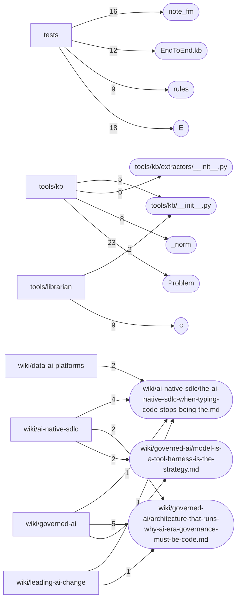

# Dependencies and hotspots — kfcor

Derived from `code-graph/code-graph.jsonl` and `code-graph/metrics.json`. Hotspots are fan-in counts only (calls, renders, imports and links into a node); the bundle pins one commit, so there is no churn signal.

## External dependencies

| Package | Files that import or declare it |
|---|---:|
| `pathlib` | 17 |
| `typing` | 11 |
| `json` | 7 |
| `sys` | 7 |
| `datetime` | 6 |
| `kb` | 6 |
| `re` | 6 |
| `os` | 5 |
| `unittest` | 5 |
| `dataclasses` | 4 |
| `jsonschema` | 4 |
| `tempfile` | 4 |
| `argparse` | 3 |
| `llmw2` | 3 |
| `shutil` | 3 |
| `yaml` | 3 |
| `collections` | 2 |
| `ingest` | 2 |
| `networkx` | 2 |
| `semantica` | 2 |
| `subprocess` | 2 |
| `types` | 2 |
| `calendar` | 1 |
| `fs` | 1 |
| `functools` | 1 |
| `hashlib` | 1 |
| `llmwiki2` | 1 |
| `logging` | 1 |
| `module` | 1 |
| `numpy` | 1 |

## Entry points

- `.github/ci-run.sh (cli-main)`
- `tests/test_flow.py (cli-main)`
- `tests/test_governance_graph.py (cli-main)`
- `tests/test_ingest.py (cli-main)`
- `tests/test_rules.py (cli-main)`
- `tests/test_semantic_layer.py (cli-main)`
- `tools/kb/__main__.py (cli-main)`
- `tools/librarian/ingest.py (cli-main)`
- `tools/librarian/seed_from_site.py (cli-main)`

## Fan-in hotspots

| Node | Fan-in |
|---|---:|
| `tools/kb/validate.py::Problem` | 23 |
| `tests/test_semantic_layer.py::E` | 18 |
| `tests/helpers.py::note_fm` | 16 |
| `tests/test_flow.py::EndToEnd.kb` | 12 |
| `tests/test_rules.py::rules` | 9 |
| `tools/kb/extractors/__init__.py` | 9 |
| `tools/librarian/dump-site-content.js::c` | 9 |
| `tools/kb/extractors/resolution.py::_norm` | 8 |
| `wiki/ai-native-sdlc/the-ai-native-sdlc-when-typing-code-stops-being-the.md` | 8 |
| `wiki/governed-ai/architecture-that-runs-why-ai-era-governance-must-be-code.md` | 8 |
| `wiki/governed-ai/model-is-a-tool-harness-is-the-strategy.md` | 8 |
| `tools/kb/__init__.py` | 7 |
