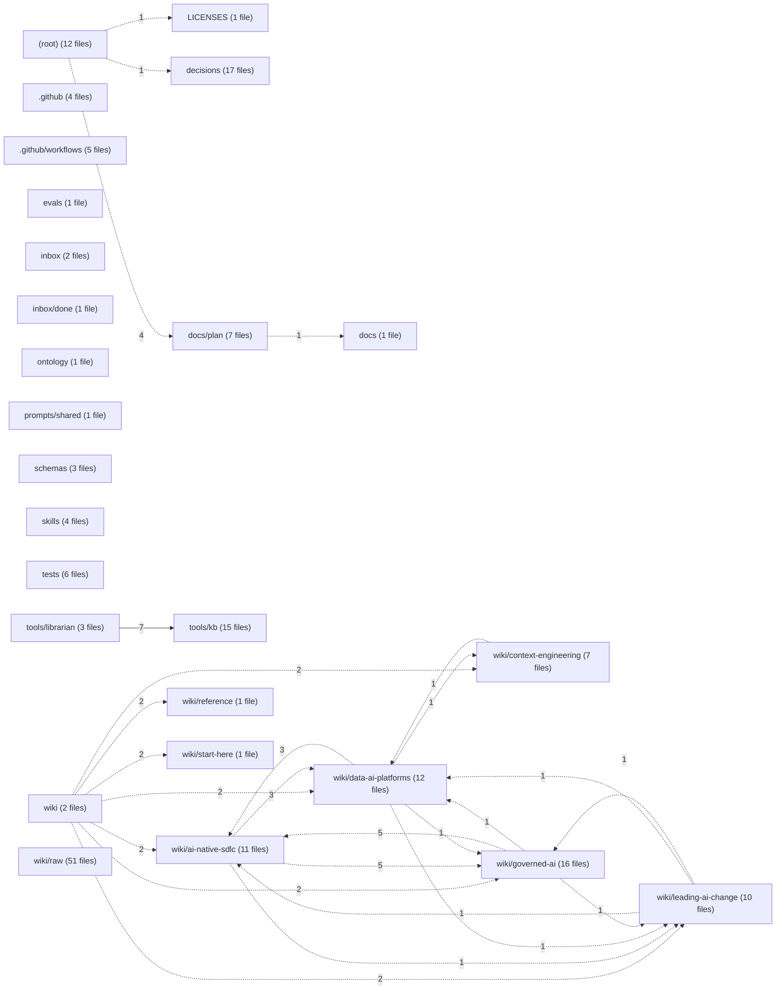

# Module view — kfcor

Derived from `code-graph/code-graph.jsonl`; regenerated by the bundle builder and verified by reproduction (gate G11). Directories are aggregated to two path segments; at most 50 directories and 150 edges are drawn.

| Directory | Files | Symbols | Outgoing deps | Incoming deps |
|---|---:|---:|---:|---:|
| `(root)` | 12 | 0 | 6 | 0 |
| `.github` | 4 | 0 | 0 | 0 |
| `.github/workflows` | 5 | 0 | 0 | 0 |
| `LICENSES` | 1 | 0 | 0 | 1 |
| `decisions` | 17 | 0 | 0 | 1 |
| `docs` | 1 | 0 | 0 | 1 |
| `docs/plan` | 7 | 0 | 1 | 4 |
| `evals` | 1 | 0 | 0 | 0 |
| `inbox` | 2 | 0 | 0 | 0 |
| `inbox/done` | 1 | 0 | 0 | 0 |
| `ontology` | 1 | 0 | 0 | 0 |
| `prompts/shared` | 1 | 0 | 0 | 0 |
| `schemas` | 3 | 0 | 0 | 0 |
| `skills` | 4 | 0 | 0 | 0 |
| `tests` | 6 | 124 | 0 | 0 |
| `tools/kb` | 15 | 113 | 0 | 7 |
| `tools/librarian` | 3 | 15 | 7 | 0 |
| `wiki` | 2 | 0 | 14 | 0 |
| `wiki/ai-native-sdlc` | 11 | 0 | 9 | 11 |
| `wiki/context-engineering` | 7 | 0 | 1 | 3 |
| `wiki/data-ai-platforms` | 12 | 0 | 6 | 8 |
| `wiki/governed-ai` | 16 | 0 | 7 | 9 |
| `wiki/leading-ai-change` | 10 | 0 | 3 | 5 |
| `wiki/raw` | 51 | 0 | 0 | 0 |
| `wiki/reference` | 1 | 0 | 0 | 2 |
| `wiki/start-here` | 1 | 0 | 0 | 2 |
