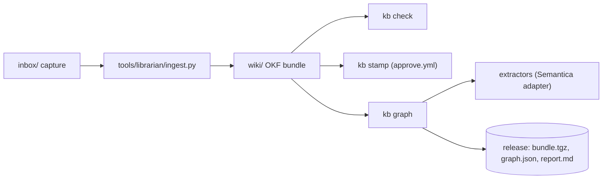

# Application architecture — Knowledge Foundation core

## Components

| Component | Responsibility |
|---|---|
| `wiki/` | the OKF bundle: theme folders, notes, `raw/` source copies, and an `index.md` and `log.md` per folder [^readme-map] |
| `tools/kb/` | governance tooling: validate, dates, blocklist, normalize, stamp, propose, graph and evals [^readme-map] |
| `tools/kb/extractors/` | the semantic layer: the Semantica adapter, entity resolution and typed relations [^readme-map] |
| `tools/librarian/` | ingest through LLM-Wiki-V2 and the one-off seed from the essays site [^readme-map] |
| `skills/`, `prompts/`, `AGENTS.md` | standing orders and procedures for the curator agent and house style for the librarian [^readme-map] |
| `.github/workflows/` | `tests`, `approve`, `publish`, `weekly` and `ingest` automation [^plan-wf] |

## Entry points

The code graph records nine command-line entry points: `tools/kb/__main__.py`, `tools/librarian/ingest.py`, `tools/librarian/seed_from_site.py`, `.github/ci-run.sh` and the five test modules.[^g-ci] [^g-kbmain] [^g-ingest] [^g-seed]

`kb`'s `main` builds an argparse tree with one subcommand per governance operation and routes each to a module function; `check` chains `validate`, `dates`, the blocklist scan and the offline evals and ORs their exit codes.[^kb-sub] [^kb-check]

## Governance modules

`okf.py` reads and writes OKF documents with a YAML loader that drops the timestamp resolver, so dates stay as the text written and a round trip does not rewrite bytes; it also walks a bundle into notes and raw copies and derives the trust tier from `verified`.[^okf-loader] [^okf-trust]

`validate.validate` applies the structural rules (schema, folders, kind, footnotes, sources, links, relations, canonical essay, public classification) and returns `Problem` records; `Problem` is the most depended-on node in the code graph, with a fan-in of 23.[^val-rules] [^g-problem]

`governance.py` holds the three write operations: `normalize` fills defaults without overwriting, `stamp` appends a human verification event, and `propose` copies machine-suggested relations into frontmatter.[^gov-doc]

## Graph build

`graph.build` assembles a networkx `DiGraph` from themes, notes, sources, links and frontmatter relations, and an authored typed relation replaces an untyped link between the same pair.[^graph-backbone] [^graph-edge]

When an extractor is supplied, the build passes it the note texts and the pairs the author already linked, adds `mentions` edges to resolved entities, and adds model-proposed typed relations only between notes with no edge in either direction.[^graph-ext] [^graph-props]

Layout and Louvain communities are computed with fixed seeds inside the build, and the result is validated against `schemas/graph.schema.json` before it is returned.[^graph-layout] [^graph-validate]

The extractor contract is a `Protocol` with one method, `extract(notes) -> Extraction`, and `get` lazily imports either the Semantica adapter or the null extractor by name, so the builder never imports an extraction library itself.[^ext-proto] [^ext-getfn] [^ext-get]

## Librarian

`ingest.ingest` validates the capture, calls LLM-Wiki-V2's `Wiki.ingest`, writes `published_at`, `origin_kind` and `license_note` onto the raw copy, and moves the capture to `inbox/done/`; the wiki factory is injectable, which the flow test uses with scripted models.[^ing-flow] [^flow-factory]

*Assessment:* The graph builder never imports an extraction library directly and the librarian takes its engine through a factory, so the two model-dependent edges of the system are each one seam wide.[^ext-get] [^ing-flow]

*Assessment:* Fixed seeds for layout and communities make the published `graph.json` reproducible for the same input, though the `generated_at` timestamp still changes on every build.[^graph-layout] [^graph-validate]

[^readme-map]: src · README.md#L125-L138 · sha256:f8a38158ef09d99d30d6f83b0c74e1ca386c8f4a64949d50cc24be8bd5362d55
[^plan-wf]: src · docs/plan/03-github-automation.md#L25-L33 · sha256:23741ab2ad71030bd9583b61eac1e0223949b462483c8c289439f7d461a93d4e
[^g-ci]: graph · .github/ci-run.sh
[^g-kbmain]: graph · tools/kb/__main__.py
[^g-ingest]: graph · tools/librarian/ingest.py::main
[^g-seed]: graph · tools/librarian/seed_from_site.py::main
[^kb-sub]: src · tools/kb/__main__.py#L32-L58 · sha256:179500f67d6902b22acc11c8c90b947011cf5586654c8bce8f420e725836513d
[^kb-check]: src · tools/kb/__main__.py#L79-L84 · sha256:73bfa1039d86a7f80a9c11716ea253046dde87f10e099ba589b10ab8973fd2b2
[^okf-loader]: src · tools/kb/okf.py#L1-L33 · sha256:4f479a93c99aa67f1486902825121f119185d9ea6f0ae30f0ffcb14c7f737354
[^okf-trust]: src · tools/kb/okf.py#L133-L140 · sha256:5290c69185ba5573b4feb56a9d123b627e703063c5c59d4ce32520e2ba50375f
[^val-rules]: src · tools/kb/validate.py#L1-L33 · sha256:cb213ebf33150ca3c830590f7174fca6529a5aeef0aaa737daa808388392713e
[^g-problem]: graph · tools/kb/validate.py::Problem
[^gov-doc]: src · tools/kb/governance.py#L1-L8 · sha256:e553e19c09ab0405391c4f0adc99c64e6e9bb65c62a7126075c100fb88b59acf
[^graph-backbone]: src · tools/kb/graph.py#L68-L89 · sha256:4c1125a7efb983bd7a683f895f8d928a262edcdaf0c698e1cf8c31d20fcd368f
[^graph-edge]: src · tools/kb/graph.py#L91-L126 · sha256:2e388555783d6803a35a397ed636ae5002f2a24465980b61c484879c6c76d187
[^graph-ext]: src · tools/kb/graph.py#L128-L150 · sha256:81aa4056f22df7f1c193eb7ddbf11d39c5b0c3269f073b17d5f1caf8baac89d9
[^graph-props]: src · tools/kb/graph.py#L151-L161 · sha256:d689e624219e0ca4f61c3b1c1ab9404f2feae619b1ffbff2c25eaf6aa108b4e0
[^graph-layout]: src · tools/kb/graph.py#L163-L167 · sha256:8b99f90ad06fcb5081f20726a5990c1f79032b877f7dd8ec250394041b49ca6e
[^graph-validate]: src · tools/kb/graph.py#L178-L190 · sha256:0181459334184149efd57e6e4f9ba6a1e2d0a941e4e3cfbc174b9b7cd7dba6eb
[^ext-proto]: src · tools/kb/extractors/__init__.py#L60-L63 · sha256:d9ffd7feacbce97ee1a56d3ab39590c1caa168b62413125284e17c964f63afde
[^ext-getfn]: src · tools/kb/extractors/__init__.py#L66-L75 · sha256:9b932ae05adfd838a7077817c65b2a7aa4c1beb4f9eb5d04c3f951ab84b32769
[^ext-get]: src · tools/kb/extractors/__init__.py#L1-L5 · sha256:c473d29f4faa25a1a99aac485b05ef495b5db11ba8937d0ef2abb3c90c084a45
[^ing-flow]: src · tools/librarian/ingest.py#L93-L105 · sha256:ba61aef0aa797b6977e03681adbc3ffaf45eed458b90f8db152c376bcf893826
[^flow-factory]: src · tests/test_flow.py#L130-L142 · sha256:580b108d74d3180837b98d341178adb41b42ef7dbc1dcc4923dd3cf8ffdea00a
