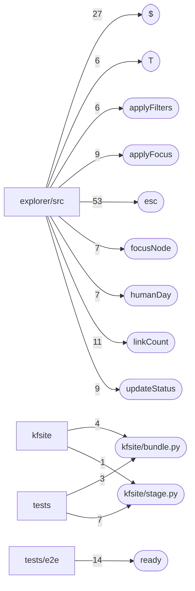

# Dependencies and hotspots — kfsit

Derived from `code-graph/code-graph.jsonl` and `code-graph/metrics.json`. Hotspots are fan-in counts only (calls, renders, imports and links into a node); the bundle pins one commit, so there is no churn signal.

## External dependencies

| Package | Files that import or declare it |
|---|---:|
| `pathlib` | 13 |
| `json` | 7 |
| `re` | 7 |
| `sys` | 7 |
| `shutil` | 6 |
| `yaml` | 6 |
| `@playwright/test` | 4 |
| `os` | 4 |
| `tempfile` | 3 |
| `typing` | 3 |
| `unittest` | 3 |
| `urllib` | 3 |
| `argparse` | 2 |
| `esbuild` | 2 |
| `fs` | 2 |
| `graphology` | 2 |
| `markdown` | 2 |
| `path` | 2 |
| `sigma` | 2 |
| `tarfile` | 2 |
| `dataclasses` | 1 |
| `datetime` | 1 |
| `events` | 1 |
| `functools` | 1 |
| `http` | 1 |
| `io` | 1 |
| `jsonschema` | 1 |
| `node:path` | 1 |
| `node:url` | 1 |
| `posixpath` | 1 |

## Entry points

- `.github/ci-run.sh (cli-main)`
- `kfsite/__main__.py (cli-main)`
- `scripts/build.sh (cli-main)`
- `scripts/fetch_release.py (cli-main)`
- `scripts/make_quartz_config.py (cli-main)`
- `scripts/pip_install.sh (cli-main)`
- `scripts/vercel_build.sh (cli-main)`
- `tests/serve.py (cli-main)`
- `tests/test_fetch_release.py (cli-main)`
- `tests/test_post.py (cli-main)`
- `tests/test_stage.py (cli-main)`

## Fan-in hotspots

| Node | Fan-in |
|---|---:|
| `explorer/src/explorer.ts::esc` | 53 |
| `explorer/src/explorer.ts::$` | 27 |
| `tests/e2e/explorer.spec.ts::ready` | 14 |
| `explorer/src/explorer.ts::linkCount` | 11 |
| `explorer/src/explorer.ts::applyFocus` | 9 |
| `explorer/src/explorer.ts::updateStatus` | 9 |
| `kfsite/stage.py` | 8 |
| `explorer/src/explorer.ts::focusNode` | 7 |
| `explorer/src/explorer.ts::humanDay` | 7 |
| `kfsite/bundle.py` | 7 |
| `explorer/src/explorer.ts::T` | 6 |
| `explorer/src/explorer.ts::applyFilters` | 6 |
