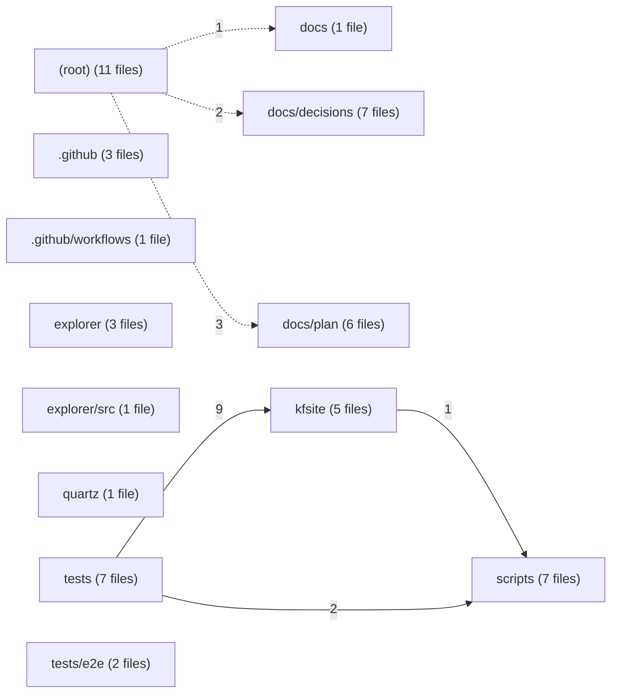

# Module view — kfsit

Derived from `code-graph/code-graph.jsonl`; regenerated by the bundle builder and verified by reproduction (gate G11). Directories are aggregated to two path segments; at most 50 directories and 150 edges are drawn.

| Directory | Files | Symbols | Outgoing deps | Incoming deps |
|---|---:|---:|---:|---:|
| `(root)` | 11 | 0 | 6 | 0 |
| `.github` | 3 | 0 | 0 | 0 |
| `.github/workflows` | 1 | 0 | 0 | 0 |
| `docs` | 1 | 0 | 0 | 1 |
| `docs/decisions` | 7 | 0 | 0 | 2 |
| `docs/plan` | 6 | 0 | 0 | 3 |
| `explorer` | 3 | 1 | 0 | 0 |
| `explorer/src` | 1 | 78 | 0 | 0 |
| `kfsite` | 5 | 42 | 1 | 9 |
| `quartz` | 1 | 0 | 0 | 0 |
| `scripts` | 7 | 3 | 0 | 3 |
| `tests` | 7 | 58 | 11 | 0 |
| `tests/e2e` | 2 | 12 | 0 | 0 |
