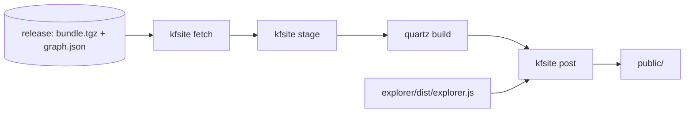

# Application architecture — Knowledge Foundation site

## Components

| Component | Responsibility | Evidence |
|---|---|---|
| `kfsite/__main__.py` | CLI with three subcommands, `fetch`, `stage` and `post` | [^cli] |
| `kfsite/bundle.py` | Reads an OKF v0.2 bundle into `Doc` objects, computes backlinks, themes, sources and JSON-LD | [^bundle-doc][^g-bundle-cls] |
| `kfsite/stage.py` | `Stager` writes Quartz content: one page per note, one index per theme, and the notes index | [^stage-write] |
| `kfsite/post.py` | `finish` completes `public/` after Quartz; `check_output` reports reader-facing problems | [^post-doc][^check-output] |
| `scripts/fetch_release.py` | Downloads `bundle.tgz` and `graph.json` from the latest knowledge release or the tag in `KF_RELEASE` | [^fetch] |
| `scripts/make_quartz_config.py` | Regenerates `quartz.config.yaml` from Quartz's default plus a fixed list of changes, validated against Quartz's JSON Schema | [^qcfg-make] |
| `explorer/src/explorer.ts` | The home page explorer: graphology graph, Sigma renderer, layout, filters, search, side panel, list view | [^g-explorer][^explorer-head] |
| `explorer/theme.js` | Dark-by-default theme choice stored in `localStorage.theme` and shared with Quartz pages | [^theme-js] |

The code graph lists `kfsite/__main__.py`, `scripts/build.sh`, `scripts/fetch_release.py`, `scripts/make_quartz_config.py` and `scripts/vercel_build.sh` among the entry points of the repository.[^g-main][^g-build-sh]

## Build flow

`scripts/build.sh` rebuilds the explorer bundle from locked npm packages, obtains a bundle (local `KF_BUNDLE`, a knowledge branch via `KF_BRANCH`, or the latest release), checks out Quartz at the commit in `quartz.ref`, stages, builds with Quartz and runs the post step.[^build-explorer][^build-branch][^build-steps]

## Reading the bundle

`Bundle.__init__` loads every `*.md` under the bundle root except dot-paths, `index.md` and `log.md`, and records a backlink on each note that another non-raw note links to.[^bundle-init]

Notes under `raw/` are source copies: `Doc.is_raw` marks them and `Bundle.notes` excludes them from the published note list.[^doc-raw][^bundle-notes]

A note's trust tier is derived from its `verified` entries: `human-reviewed` when any verifier starts with `human:`, `machine-confirmed` otherwise, and `unverified` when there are none.[^trust]

## Staging

`Stager.note` builds each Quartz page from a provenance callout, the note body with headings demoted one level, a numbered Sources list, and a See also list that puts typed frontmatter relations first.[^note-body][^callout][^sources-list][^relations]

`Stager.relink` rewrites Markdown links to site paths; links to unpublished source copies point at the original resource when it is an `https://` URL, otherwise only the link text is kept.[^relink]

The Quartz index is written to `notes/index.md` because `/` is reserved for the explorer.[^stage-write]

## Post-processing

`finish` fails the build with `BuildError` when Quartz did not produce a page for every note, every theme and the notes index.[^post-expected]

For every note page it injects JSON-LD once and writes the note's original OKF file next to it as a Markdown twin.[^post-jsonld]

It rewrites absolute links on the wiki's own domain into same-site links carrying `data-router-ignore`, so Quartz's single-page router does not swallow navigation to the explorer.[^same-site]

It writes `llms.txt` and, when missing, `robots.txt`, then copies `graph.json` and installs the explorer at both `/graph/` and `/`.[^post-llms][^post-explorer]

## Explorer flow

The explorer fetches `/graph.json`, retypes `ext:` nodes as `Entity`, and accepts only `https://` URLs and same-site paths as link targets.[^explorer-load]

Node positions come from the client-side `layout` function: themes on a ring ordered by cross-theme links, notes orbiting their theme's hub, sources beside their note and entities among the notes that mention them.[^g-layout][^layout-ring][^layout-call]

A `?node=` deep link skips the entrance animation and focuses that node; an unknown id is removed from the URL and the whole map is shown.[^deeplink]

*Assessment:* The explorer's header comment still says positions come precomputed from the knowledge repository, but the code ignores the `x`/`y` fields of `graph.json` and computes its own layout; the comment is stale and could mislead a maintainer.[^explorer-head][^layout-call]

*Assessment:* `stage` and `post` share one parser (`kfsite/bundle.py`), so the content Quartz renders and the JSON-LD, twins and `llms.txt` added afterwards cannot disagree about which notes exist.[^bundle-doc][^post-expected]

*Assessment:* The `post` step doubles as a build-time quality gate (missing pages, absolute self-links, em dashes and email addresses fail the CLI), which moves content checks from review time to build time.[^check-output][^cli]

[^cli]: src · kfsite/__main__.py#L18-L54 · sha256:a6d697838a2a86c10788542df45ccda77b165b73d45865193d89766de727a105
[^bundle-doc]: src · kfsite/bundle.py#L1-L6 · sha256:20d67b21750bf86d249eb52a407f0171047f81356ccdb831fc3de6f6a5907566
[^g-bundle-cls]: graph · kfsite/bundle.py::Bundle
[^stage-write]: src · kfsite/stage.py#L138-L152 · sha256:3b09083b699c2d59c9246cc0f7db0d205b5a6878cb36d7cbbfeb351af06610cf
[^post-doc]: src · kfsite/post.py#L1-L9 · sha256:84ef80179e2e1fa72e4a7f0350401613f712e64d062721ab22eae5ac5fce1f3a
[^check-output]: src · kfsite/post.py#L114-L129 · sha256:5f2ba0e62ff2c49ed7b469a9c6b20ed88e8f8c0a31029c101b5c91b0e06368ea
[^fetch]: src · scripts/fetch_release.py#L36-L49 · sha256:c2f7c345b5a17c39ef0ebeda3d323067bf4e5fd9104640ccf38a5626cbf8c217
[^qcfg-make]: src · scripts/make_quartz_config.py#L57-L78 · sha256:dab121346a440c54ca11a3c61c049a19480595f40648f39153bda6a30fd590d8
[^g-explorer]: graph · explorer/src/explorer.ts
[^explorer-head]: src · explorer/src/explorer.ts#L1-L13 · sha256:d0ffe5843a69c25f954255e81dec298de7660408851dda033a67db76b7b04130
[^theme-js]: src · explorer/theme.js#L1-L7 · sha256:3f2fb5ec6db662f6e2b75ed7515049105f0c8b5b2f5c17617230e76cb92602cd
[^g-main]: graph · kfsite/__main__.py::main
[^g-build-sh]: graph · scripts/build.sh
[^build-explorer]: src · scripts/build.sh#L16-L20 · sha256:4c9ed7064ae519839a6ede2aac9753fbdfc42f6408ceac76f70c5cb38bfd8114
[^build-branch]: src · scripts/build.sh#L22-L38 · sha256:cc8bc3051220a4240ee74028a000af45a5e8c344d8c6ee4baa7aa36347b61aa7
[^build-steps]: src · scripts/build.sh#L40-L58 · sha256:e5513efc35e0354623bf6f1d77537052e36614444519c654e2edc25ed8c0e6f3
[^bundle-init]: src · kfsite/bundle.py#L133-L148 · sha256:26b989e217696d641f783b56f60df72443cc3f790d39801e17296e412669d718
[^doc-raw]: src · kfsite/bundle.py#L109-L111 · sha256:84d573117791b17959a4ce5b6af7543ba06c0332498058c03696d5c47ade8499
[^bundle-notes]: src · kfsite/bundle.py#L150-L151 · sha256:ee3e932b3121a42ea20a2dd0239da3317405d5e6e73fa5af149ed7de342c059d
[^trust]: src · kfsite/bundle.py#L70-L79 · sha256:c4310c64195d47de5f56dd3f6b9919a1d3abdb28d456cc94fa56adcea5730513
[^note-body]: src · kfsite/stage.py#L61-L71 · sha256:c6568526af76304afe461bd706667f936f8e8408339b73466f766eb7368c04a4
[^callout]: src · kfsite/stage.py#L73-L94 · sha256:ea91b135f6f6b9dbad39b603bb3318515ac580765a60c1abf502397859270dda
[^sources-list]: src · kfsite/stage.py#L96-L102 · sha256:5e28c577983b0885e56689ffe6e1889d08e94c7b45a431e149da997f913f6798
[^relations]: src · kfsite/stage.py#L103-L112 · sha256:02d0f3b2c52358f69f097121bbdade0d4a68f473609ddc6c5f8534ba922ab80a
[^relink]: src · kfsite/stage.py#L47-L59 · sha256:49d72fd9dc5ed6b8301cbafad27e7b146a45505ce3118276411a347486c66637
[^post-expected]: src · kfsite/post.py#L57-L67 · sha256:7ae705d79de6a87aef37c559af8207c69d8f276b7b3fcc9c0f2d9dd499322de5
[^post-jsonld]: src · kfsite/post.py#L69-L77 · sha256:af4e33d73aca7f4ebb6a0803f0fbdf5363730ca3644d62669b6f3a879c8b3ecb
[^same-site]: src · kfsite/post.py#L37-L54 · sha256:6d4ce65b8efd081a40157b4e63eed74d2112b8e0a806ac86518f73af4492d3fa
[^post-llms]: src · kfsite/post.py#L87-L96 · sha256:4a3f5f187a4602e8a8f33c081c357db74635b018d62c6488779cedb72fbec36b
[^post-explorer]: src · kfsite/post.py#L98-L110 · sha256:d017d031d05121f3d76b76a9d1aaaeb12a7fd2e7e983bed78bfa144d739656d2
[^explorer-load]: src · explorer/src/explorer.ts#L772-L782 · sha256:71f2ac1fdcbc78ce01f337bfc8d21e8c277893f41706e6b15738318eec29060d
[^g-layout]: graph · explorer/src/explorer.ts::layout
[^layout-ring]: src · explorer/src/explorer.ts#L144-L162 · sha256:e9db64af8d7d09274122d2affeab6e35d26c8bfe24d4b02a8340f595310ac7a2
[^layout-call]: src · explorer/src/explorer.ts#L795-L802 · sha256:c47931f7b1d9cebefc148bb22baad207cb44671c5b6e1594ca97a00b1e5369ae
[^deeplink]: src · explorer/src/explorer.ts#L890-L901 · sha256:7d28286a8d40a04434fc473b20e64170f6b03cc9bec0abf53bdfd57e1f9a2c0f
